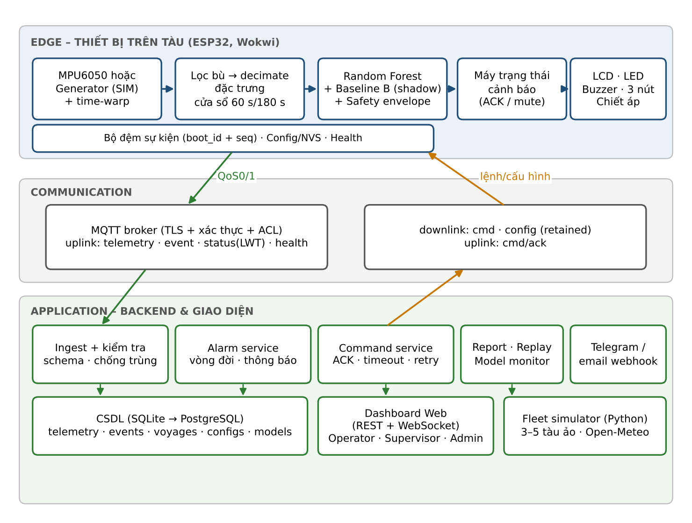
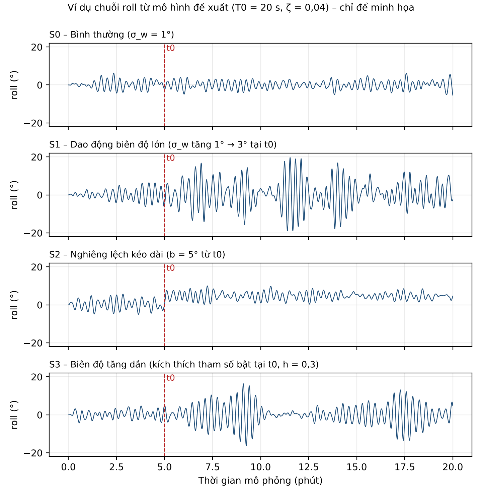
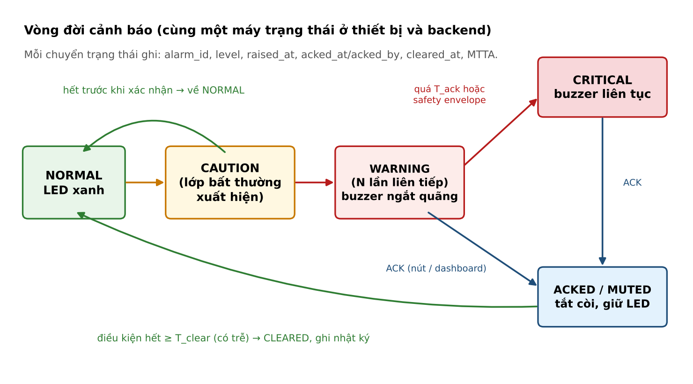

**ĐỀ XUẤT ĐỒ ÁN CUỐI KỲ**

**MÔN HỌC: INTERNET OF THINGS (IoT)**

**SMART VESSEL MOTION GUARD**

**HỆ THỐNG IOT GIÁM SÁT, CẢNH BÁO VÀ QUẢN LÝ SỰ KIỆN DAO ĐỘNG TÀU THUYỀN
CHỞ CONTAINER**

*Nhằm hỗ trợ bảo vệ hàng hóa và môi trường biển*

Lĩnh vực: Logistics biển bền vững • IoT hai chiều • Edge AI / TinyML

Hình thức triển khai: Wokwi + ESP32 + Machine Learning + MQTT + Web
Dashboard

*Phiên bản 2.0 – bản hiệu chỉnh theo góp ý của giảng viên*

|                          |                           |
|:-------------------------|:--------------------------|
| **Nhóm thực hiện**       | ………………………………………………………………… |
| **Thành viên**           | ………………………………………………………………… |
| **Giảng viên hướng dẫn** | ………………………………………………………………… |
| **Ngày nộp**             | ………………………………………………………………… |

# TÓM TẮT ĐỀ ÁN

Smart Vessel Motion Guard là nguyên mẫu IoT + TinyML mô phỏng việc giám
sát chuyển động của tàu container khi hành trình. ESP32 thu nhận dữ liệu
từ cảm biến MPU6050 (hoặc bộ phát tín hiệu mô phỏng), lọc nhiễu, trích
xuất đặc trưng theo cửa sổ thời gian và dùng mô hình Random Forest chạy
trực tiếp trên thiết bị để nhận biết bốn mẫu chuyển động: bình thường,
dao động biên độ lớn, nghiêng lệch kéo dài và dao động tăng biên độ dần.

Hệ thống không dừng ở việc hiển thị số liệu thời gian thực. Đề án xây
dựng một vòng vận hành khép kín gồm sáu nhóm chức năng: (1) giám sát
thời gian thực; (2) cảnh báo có vòng đời xác nhận – leo thang – giải
tỏa; (3) điều khiển và cấu hình từ xa hai chiều qua MQTT có xác nhận
lệnh; (4) quản lý chuyến đi với báo cáo tự động và phát lại (replay);
(5) giám sát sức khỏe thiết bị và hiệu chuẩn; (6) giám sát mô hình học
máy (chạy song song với baseline, phát hiện lệch phân phối). Hai chức
năng mở rộng gồm bối cảnh biển và mô phỏng đội tàu.

Dữ liệu huấn luyện được sinh có kiểm soát từ mô hình dao động roll một
bậc tự do chịu kích động sóng ngẫu nhiên và kích thích tham số; tập kiểm
thử dùng các phiên độc lập, miền tham số dịch chuyển và một bộ sinh khác
để hạn chế đánh giá quá lạc quan. Hệ thống được đánh giá bằng macro-F1,
tỉ lệ cảnh báo giả, độ trễ phát hiện, thời gian đáp ứng lệnh và độ chính
xác của báo cáo; có đối chứng với phương pháp ngưỡng và bộ quy tắc theo
thời gian.

> **Giới hạn cốt lõi**
>
> Đây là công cụ hỗ trợ nhận diện bất thường dựa trên chuyển động ở quy mô mô phỏng. Hệ thống không đo trực tiếp độ ổn định tàu theo GM/GZ, không dự báo lật tàu, không điều khiển lái hoặc động cơ và không thay thế hệ thống an toàn hàng hải được chứng nhận. Các lệnh từ xa chỉ thay đổi cấu hình của chính thiết bị giám sát và không thể tắt cảnh báo cục bộ.

# MỤC LỤC

> 1\. Bối cảnh, sự cần thiết và bài toán
>
> 2\. Mục tiêu, phạm vi, hệ chức năng và kết quả dự kiến
>
> 3\. Đối tượng sử dụng và yêu cầu hệ thống
>
> 4\. Kiến trúc tổng thể và luồng dữ liệu hai chiều
>
> 5\. Thiết kế mô phỏng phần cứng trên Wokwi
>
> 6\. Mô hình tín hiệu chuyển động và các kịch bản
>
> 7\. Xử lý tín hiệu và thiết kế Machine Learning
>
> 8\. Các chức năng điều khiển, phân tích và vận hành
>
> 9\. TinyML, MQTT, bảo mật và Dashboard
>
> 10\. Thiết kế thí nghiệm và tiêu chí đánh giá
>
> 11\. Kế hoạch triển khai, phân công và sản phẩm bàn giao
>
> 12\. Rủi ro, giới hạn và giá trị bền vững
>
> 13\. Kịch bản trình diễn và câu hỏi bảo vệ
>
> 14\. Tài liệu tham khảo
>
> Phụ lục A. Giao thức và dữ liệu mẫu
>
> Phụ lục B. Định dạng dữ liệu ML
>
> Phụ lục C. Đối chiếu góp ý và cách đáp ứng
>
> Phụ lục D. Checklist nghiệm thu

# 1. BỐI CẢNH, SỰ CẦN THIẾT VÀ BÀI TOÁN

## 1.1. Bối cảnh thực tế

Trong vận tải container đường biển, tàu luôn chịu tác động của sóng, gió
và trạng thái khai thác. Dao động lắc ngang (roll), lắc dọc (pitch) và
góc nghiêng lệch kéo dài có thể tạo thêm rủi ro cho việc chằng buộc, bảo
quản và xếp dỡ hàng hóa. Theo báo cáo World Shipping Council công bố năm
2026, ước tính khoảng 1.478 container bị mất trên biển trong năm 2025,
tăng từ 576 container của năm 2024 \[1\], \[15\]. Một sự cố lớn đơn lẻ
chiếm khoảng 640 container (khoảng 43% tổng số) \[15\]; báo cáo cũng ghi
nhận nguyên nhân đa dạng như thời tiết và biển bất lợi, cháy, dịch
chuyển hàng hóa và đổ chồng container. Vì vậy cần hiểu đúng: giám sát
chuyển động chỉ liên quan đến một phần các nguyên nhân này.

Từ ngày 01/01/2026, các sửa đổi liên quan SOLAS và MARPOL về báo cáo
container thất lạc trên biển có hiệu lực; IMO nhấn mạnh container rơi
xuống biển là mối nguy cho an toàn hàng hải và môi trường biển \[2\].
Một dạng chuyển động đáng chú ý là lắc tham số (parametric rolling),
trong đó biên độ roll có thể tăng nhanh khi chu kỳ gặp sóng gần bằng một
nửa chu kỳ lắc tự nhiên của tàu; hiện tượng này được đề cập trong hướng
dẫn của IMO cho thuyền trưởng (MSC.1/Circ.1228) \[12\] và trong báo cáo
điều tra của MAIB về sự cố mất 137 container trên tàu CMA CGM G.
Washington năm 2018 \[11\]. Đề án lựa chọn hướng tiếp cận theo dõi sớm
các chỉ báo chuyển động bất thường để phục vụ nghiên cứu và đào tạo,
không khẳng định có thể ngăn trực tiếp sự cố rơi container.

## 1.2. Vấn đề cần giải quyết

- Một số biểu hiện bất thường hình thành theo thời gian (biên độ tăng
  dần, nghiêng lệch kéo dài) khó phản ánh đầy đủ bằng một ngưỡng góc tức
  thời duy nhất.

- Chu kỳ lắc tự nhiên của tàu container lớn thường vào cỡ vài chục giây
  (ví dụ khoảng 32 s với tàu dài 240 m trong tài liệu hướng dẫn của West
  P&I \[13\]). Do đó cửa sổ phân tích phải đủ dài để chứa nhiều chu kỳ
  lắc.

- Khi tàu ở xa bờ, kết nối internet không phải lúc nào cũng sẵn có; cảnh
  báo cơ bản phải hoạt động ngay tại thiết bị.

- Việc **chỉ hiển thị số liệu thời gian thực là chưa đủ** cho một hệ
  thống vận hành: cần xác nhận cảnh báo của người trực, cấu hình và điều
  khiển thiết bị từ xa, truy vết sự kiện, báo cáo sau chuyến đi, theo
  dõi sức khỏe thiết bị và theo dõi chất lượng mô hình theo thời gian.

- Trong môi trường đào tạo không có dữ liệu chuyển động thực của tàu;
  cần thiết kế mô phỏng minh bạch, lặp lại được và có phương pháp kiểm
  chứng.

## 1.3. Câu hỏi nghiên cứu

1.  Có thể dùng ESP32 kết hợp MPU6050 để thu nhận và xử lý các chỉ báo
    chuyển động cơ bản của tàu ở quy mô mô phỏng, với thang thời gian
    phù hợp chu kỳ lắc của tàu hay không?

2.  Mô hình TinyML có nhận diện các mẫu chuyển động bất thường (kể cả ca
    khó như nghiêng tạm thời hợp lệ và ca kết hợp) tốt hơn ngưỡng cố
    định và bộ quy tắc theo thời gian trên tập kiểm thử độc lập không?

3.  Có thể bảo đảm cảnh báo cục bộ vẫn hoạt động khi mạng MQTT tạm ngắt,
    đồng thời đồng bộ sự kiện không mất, không trùng khi kết nối phục
    hồi không?

4.  Kênh điều khiển hai chiều (lệnh – xác nhận) có đáp ứng tin cậy trong
    điều kiện mạng kém mà vẫn không làm suy giảm các chức năng an toàn
    cục bộ không?

5.  Dữ liệu hành trình (báo cáo, replay, phản hồi của người trực, giám
    sát lệch phân phối) có giúp đánh giá và vận hành hệ thống cảnh báo
    một cách có thể kiểm chứng không?

# 2. MỤC TIÊU, PHẠM VI, HỆ CHỨC NĂNG VÀ KẾT QUẢ DỰ KIẾN

## 2.1. Mục tiêu tổng quát

Thiết kế, mô phỏng và đánh giá nguyên mẫu IoT + TinyML nhận diện trạng
thái dao động tàu container từ dữ liệu chuyển động, phát cảnh báo cục bộ
có vòng đời xác nhận, cho phép giám sát – điều khiển – cấu hình từ xa
hai chiều, tạo báo cáo và phát lại hành trình, đồng thời giám sát sức
khỏe thiết bị và chất lượng mô hình, nhằm minh họa ứng dụng công nghệ hỗ
trợ an toàn hàng hóa và bảo vệ môi trường biển.

## 2.2. Mục tiêu cụ thể

1.  Thiết kế mạch ESP32 + MPU6050 + LCD + LED + buzzer + 3 nút + chiết
    áp trong Wokwi; có chế độ đọc cảm biến và chế độ mô phỏng (kèm hệ số
    tăng tốc thời gian).

2.  Xây dựng bộ sinh tín hiệu dựa trên mô hình dao động roll, tạo tối
    thiểu 4 kịch bản chính và 2 kịch bản khó, lặp lại được và gắn nhãn
    rõ là dữ liệu giả lập.

3.  Xây dựng lõi xử lý bằng C (lọc, đặc trưng, suy luận, máy trạng thái
    cảnh báo) dùng chung cho ESP32 và máy chủ để kiểm thử hàng loạt.

4.  Huấn luyện Random Forest bằng Python, xuất sang mã C bằng emlearn,
    suy luận trực tiếp trên ESP32; đối chiếu với Python và với hai
    baseline.

5.  Xây dựng kênh MQTT hai chiều (telemetry, sự kiện, lệnh, xác nhận,
    cấu hình) có bộ đệm offline, chống trùng và kiểm soát an toàn lệnh.

6.  Xây dựng backend, cơ sở dữ liệu và web dashboard gồm: cảnh báo có
    vòng đời, trung tâm điều khiển, quản lý chuyến đi, báo cáo, replay,
    sức khỏe thiết bị, giám sát mô hình.

7.  Đánh giá so sánh có kiểm soát; công bố cả trường hợp ML chưa vượt
    baseline; đánh giá riêng các chức năng vận hành (lệnh, báo cáo, đồng
    bộ).

## 2.3. Hệ chức năng và mức ưu tiên

Các chức năng được chia thành bảy nhóm và gán ưu tiên theo MoSCoW: Must
là bắt buộc để nghiệm thu (MVP, chốt cuối tuần 5), Should nên có nếu
tiến độ cho phép, Could là mở rộng. Thứ tự cắt giảm khi thiếu thời gian:
Could → Should, không cắt Must.

**Bảng 2.1. Nhóm chức năng của hệ thống**

| **Nhóm** | **Tên nhóm** | **Chức năng chính** | **Ưu tiên** |
|:---|:---|:---|:---|
| G1 | Giám sát thời gian thực | Đọc cảm biến hoặc sinh tín hiệu; lọc, đặc trưng, suy luận Random Forest tại thiết bị; dashboard hiển thị roll/pitch, nhãn, chỉ số bất thường (MAI). | Must |
| G2 | Cảnh báo và vòng đời cảnh báo | Bốn mức cảnh báo; xác nhận (ACK), tắt còi tạm thời, leo thang khi không xác nhận, giải tỏa có trễ; nhật ký và thời gian phản hồi (MTTA); thông báo ra Telegram/email. | Must (thông báo ngoài: Should) |
| G3 | Điều khiển và cấu hình từ xa | Kênh lệnh có cmd_id, ACK/NACK, timeout, thử lại, idempotent; cấu hình có phiên bản và rollback; phân quyền theo vai trò; ràng buộc an toàn. | Must (phân quyền: Should) |
| G4 | Chuyến đi, báo cáo và replay | Quản lý chuyến (voyage); báo cáo tự động xuất PDF/CSV; phát lại chuyến đi với dấu mốc; người dùng gắn nhãn đúng/sai cho cảnh báo. | Must (báo cáo); Should (replay, gắn nhãn) |
| G5 | Sức khỏe thiết bị và hiệu chuẩn | Chỉ số chẩn đoán (I2C, đứng yên, bão hòa, nhiễu, heap, RSSI, hàng đợi); hiệu chuẩn độ lệch 0; điểm sức khỏe. | Should |
| G6 | Giám sát mô hình | Baseline B chạy song song (shadow mode) và theo dõi mức bất đồng; sổ đăng ký mô hình; phát hiện lệch phân phối (PSI) và Isolation Forest phía backend. | Should (shadow, registry); Could (drift) |
| G7 | Bối cảnh biển và đội tàu | Trạng thái biển (sea state) từ giá trị đặt sẵn hoặc dự báo sóng Open-Meteo; so sánh dao động kỳ vọng và quan sát; giao diện đội 3–5 tàu ảo. | Could |

## 2.4. Phạm vi trong và ngoài đề án

| **Trong phạm vi** | **Ngoài phạm vi** |
|:---|:---|
| Mô phỏng chuyển động roll/pitch bằng mô hình dao động và cảm biến MPU6050 trong Wokwi. | Tính toán ổn định thủy tĩnh GM, đường cong GZ, đánh giá theo tiêu chuẩn IMO về ổn định \[6\]. |
| Nhận diện 4 trạng thái chuyển động có nhãn mô phỏng, cộng 2 kịch bản khó. | Dự đoán chắc chắn tàu sắp lật hoặc xác định nguyên nhân thực tế của sự cố. |
| Cảnh báo tại thiết bị và trên dashboard; xác nhận, điều khiển, cấu hình từ xa cho chính thiết bị giám sát. | Điều khiển bánh lái, tốc độ, ballast hay bất kỳ hệ thống hàng hải nào; mọi lệnh chỉ tác động lên cấu hình của thiết bị giám sát. |
| Báo cáo chuyến đi, replay, sức khỏe thiết bị, giám sát mô hình trên dữ liệu mô phỏng. | Khẳng định độ chính xác trên tàu thật, hay lượng container được ngăn rơi / CO₂ giảm thực tế. |
| Kiểm tra khả thi (sanity check) trên một đoạn dữ liệu IMU thật ngắn nếu có điều kiện. | Chứng nhận, thử nghiệm trên tàu, thiết bị chịu rung và chống nước. |

## 2.5. Sản phẩm đầu ra

- Project Wokwi (sơ đồ mạch, firmware ESP32, bộ chọn kịch bản, chiết áp
  sea state) và thư viện lõi C dùng chung.

- Mã Python sinh dữ liệu, notebook huấn luyện/đánh giá, bộ dữ liệu có
  nhãn, mô hình đã xuất và sổ đăng ký mô hình.

- Backend, cơ sở dữ liệu, web dashboard với các trang: Overview, Live
  Motion, Alarms, Control Center, Voyage Reports, Replay & Review,
  Device Health, Model Monitor (và Fleet nếu có).

- Báo cáo thí nghiệm ML và hệ thống, video demo, tài liệu hướng dẫn chạy
  và README tái lập kết quả.

# 3. ĐỐI TƯỢNG SỬ DỤNG VÀ YÊU CẦU HỆ THỐNG

## 3.1. Vai trò người dùng và phân quyền

Ba vai trò được mô phỏng: Operator (người trực trên tàu, xem cảnh báo và
xác nhận), Supervisor (người giám sát ở bờ, gửi lệnh cấu hình trong phạm
vi được phép, xem báo cáo) và Admin (nhóm phát triển, quản lý thiết bị,
mô hình và người dùng). Dashboard xác thực bằng tài khoản và gán quyền
theo bảng dưới đây.

**Bảng 3.1. Phân quyền theo vai trò**

| **Thao tác** | **Operator** | **Supervisor** | **Admin** |
|:---|:---|:---|:---|
| Xem dữ liệu trực tiếp, cảnh báo, lịch sử | ✓ | ✓ | ✓ |
| Xác nhận (ACK) cảnh báo; tắt còi tạm thời (≤ 300 s) | ✓ | ✓ | ✓ |
| Gắn nhãn đúng/sai cho cảnh báo (review) | ✓ | ✓ | ✓ |
| Gửi lệnh set_profile, calibrate_zero, request_snapshot | – | ✓ | ✓ |
| Gửi lệnh set_mode, set_scenario, set_timewarp (chế độ mô phỏng) | – | – | ✓ |
| Đổi mô hình chính (RF / Baseline B), đổi cấu hình trong biên an toàn | – | – | ✓ |
| Tạo / xuất báo cáo chuyến đi; xem Model Monitor | – | ✓ | ✓ |
| Quản lý người dùng, thiết bị, khóa truy cập | – | – | ✓ |

## 3.2. Yêu cầu chức năng

**Bảng 3.2. Yêu cầu chức năng, tiêu chí nghiệm thu và ưu tiên**

| **Mã** | **Yêu cầu** | **Tiêu chí nghiệm thu** | **Ưu tiên** |
|:---|:---|:---|:---|
| FR01 | Đọc MPU6050 qua I2C, xác định trạng thái cảm biến. | Giá trị và lỗi kết nối hiển thị trên Serial/LCD. | Must |
| FR02 | Chuyển SENSOR/SIMULATION, chọn kịch bản, chỉnh sea state bằng chiết áp. | LCD và MQTT chỉ rõ nguồn dữ liệu. | Must |
| FR03 | Lọc, giảm mẫu, tính roll/pitch và đặc trưng theo cửa sổ. | Xuất được log chuỗi thời gian và đặc trưng. | Must |
| FR04 | Suy luận Random Forest trên ESP32. | Nhãn và thời gian suy luận được ghi log. | Must |
| FR05 | Dashboard hiển thị roll/pitch, nhãn, chỉ số MAI theo thời gian thực. | Độ trễ hiển thị ghi nhận được. | Must |
| FR06 | Cảnh báo LED/buzzer/LCD 4 mức, hoạt động khi mất mạng. | Vẫn cảnh báo khi ngắt MQTT. | Must |
| FR07 | Vòng đời cảnh báo: RAISED → ACKED → CLEARED, leo thang CRITICAL. | Chuỗi chuyển trạng thái khớp kịch bản kiểm thử (T09). | Must |
| FR08 | Thông báo Telegram/email khi WARNING/CRITICAL, có giới hạn tần suất. | Không gửi trùng; gộp cảnh báo cùng alarm_id. | Should |
| FR09 | Kênh lệnh downlink có cmd_id, ACK/NACK, timeout, thử lại, idempotent. | Tỉ lệ ACK và RTT đạt mục tiêu (T10). | Must |
| FR10 | Bộ lệnh: ack, mute, set_profile, calibrate_zero, set_scenario, set_mode, set_timewarp, request_snapshot, set_model. | Mỗi lệnh có điều kiện hợp lệ và mã từ chối. | Must (tập con) / Should |
| FR11 | Cấu hình có phiên bản, kiểm tra hợp lệ, rollback; ràng buộc an toàn. | Lệnh vượt biên bị NACK; không tắt được cảnh báo cục bộ. | Must |
| FR12 | Xác thực và phân quyền theo vai trò. | Thao tác ngoài quyền bị từ chối và ghi nhật ký. | Should |
| FR13 | Quản lý chuyến đi: bắt đầu, kết thúc, siêu dữ liệu. | Mọi bản ghi gắn voyage_id. | Must |
| FR14 | Báo cáo chuyến tự động; xuất PDF/CSV. | Số liệu trùng khớp tính lại độc lập (T11). | Must |
| FR15 | Replay chuyến đi có thanh thời gian, dấu mốc, tốc độ phát. | Replay khớp dữ liệu gốc (T15). | Should |
| FR16 | Gắn nhãn đúng/sai cho cảnh báo; thống kê độ chính xác vận hành. | Nhãn lưu kèm alarm_id, người gắn. | Should |
| FR17 | Chỉ số sức khỏe thiết bị và điểm sức khỏe. | Nhận diện được các lỗi chèn vào (T13). | Should |
| FR18 | Hiệu chuẩn độ lệch 0 (heel zero) khi tàu tĩnh. | Từ chối khi tín hiệu không tĩnh (NOT_STATIC). | Should |
| FR19 | Bộ đệm offline, đồng bộ bù, chống trùng (device_id + boot_id + seq). | Không mất / không trùng sau kết nối lại (T06). | Must |
| FR20 | Shadow mode: Baseline B chạy song song, ghi mức bất đồng. | Dashboard hiện tỉ lệ đồng thuận. | Should |
| FR21 | Phát hiện lệch phân phối (PSI) và Isolation Forest ở backend. | Phát hiện dịch chuyển chèn vào (T12). | Could |
| FR22 | Sổ đăng ký mô hình: phiên bản, chỉ số, băm dữ liệu huấn luyện, chi phí RAM/flash. | Mọi bản tin gắn model_version. | Should |
| FR23 | Bối cảnh biển: giá trị đặt sẵn hoặc dự báo sóng; dải kỳ vọng và quan sát. | Cờ sai lệch có tỉ lệ báo giả đo được (T16). | Could |
| FR24 | Giao diện đội 3–5 tàu ảo trên bản đồ. | Chịu tải theo T14. | Could |

## 3.3. Yêu cầu phi chức năng

- **Tính minh bạch:** mọi dữ liệu, nhãn và đồ thị gắn cờ SENSOR hoặc
  SIMULATION; báo cáo dùng thuật ngữ "mô phỏng".

- **An toàn thiết kế (fail-safe):** lỗi cảm biến, mô hình hoặc chất
  lượng dữ liệu thấp hiển thị UNKNOWN/FAULT, không mặc định "bình
  thường"; có lớp ngưỡng cứng độc lập với mô hình (mục 7.4); lệnh từ xa
  không thể vô hiệu hóa cảnh báo cục bộ.

- **Tính đáp ứng:** cập nhật phân tích mỗi 5 s thời gian mô phỏng; cảnh
  báo cục bộ chạy tại thiết bị, độc lập dashboard; mục tiêu độ trễ phát
  hiện nêu ở mục 10.4.

- **Khả năng tái lập:** cố định random seed cho mỗi phiên; ghi tham số
  bộ sinh, phiên bản bộ sinh, phiên bản mô hình và cấu hình vào log.

- **Độ tin cậy truyền thông:** QoS 1 cho sự kiện và lệnh, Last Will để
  báo thiết bị offline, bộ đệm giới hạn có chính sách ghi đè rõ ràng.

- **Bảo mật:** kết nối có xác thực, mã hóa TLS khi broker hỗ trợ, ACL
  theo topic, mỗi thiết bị một thông tin đăng nhập, không lưu khóa trong
  mã nguồn (mục 9.3).

- **Khả năng quan sát:** log có cấu trúc ở backend; mọi lệnh, thay đổi
  cấu hình và thao tác người dùng được ghi nhật ký kiểm toán.

# 4. KIẾN TRÚC TỔNG THỂ VÀ LUỒNG DỮ LIỆU HAI CHIỀU

## 4.1. Kiến trúc ba lớp

*Hình 4.1. Kiến trúc tổng thể: dữ liệu đi lên (uplink) và lệnh đi xuống
(downlink)*

**Bảng 4.1. Thành phần và trách nhiệm**

| **Lớp** | **Thành phần** | **Trách nhiệm** |
|:---|:---|:---|
| Edge / Vessel | ESP32, MPU6050 hoặc bộ sinh, lõi C (lọc, đặc trưng, RF, Baseline B, máy trạng thái cảnh báo), LCD/LED/buzzer, nút, chiết áp. | Thu thập; tính đặc trưng; suy luận; cảnh báo và xác nhận tại chỗ; chấp hành lệnh hợp lệ; đệm sự kiện offline; báo cáo sức khỏe. |
| Communication | Broker MQTT có xác thực, bộ đệm bản tin, Last Will, cấu hình retained. | Truyền telemetry/sự kiện lên; lệnh/cấu hình xuống; phát hiện mất kết nối; gửi bù. |
| Application | FastAPI hoặc Node.js (ingest, alarm, command, report), SQLite/PostgreSQL, web dashboard, bộ mô phỏng đội tàu (Python), cổng thông báo Telegram. | Lưu dữ liệu; quản lý vòng đời cảnh báo; điều phối lệnh; sinh báo cáo; replay; giám sát mô hình; hiển thị. |

## 4.2. Luồng xử lý

Uplink: SENSOR MODE (MPU6050) hoặc SIMULATION MODE (bộ sinh) →
acquireMotionSample() trả cấu trúc MotionSample chuẩn hóa theo SI → lọc
bù, giảm mẫu → hai cửa sổ (ngắn 60 s, dài 180 s) → Random Forest (và
Baseline B chạy shadow) + lớp ngưỡng cứng → máy trạng thái cảnh báo →
LCD/LED/buzzer; song song, ESP32 gửi telemetry, sự kiện, trạng thái và
sức khỏe qua MQTT → backend → cơ sở dữ liệu → dashboard.

Downlink: người dùng thao tác trên dashboard → backend kiểm tra quyền và
tính hợp lệ → xuất bản lệnh có cmd_id lên topic của thiết bị → thiết bị
kiểm tra điều kiện an toàn, áp dụng hoặc từ chối → gửi cmd/ack kèm mã
kết quả → backend cập nhật trạng thái lệnh và ghi nhật ký. Mất mạng
không được vô hiệu hóa cảnh báo cục bộ; ngược lại, lệnh quá hạn (TTL) bị
bỏ qua thay vì thực thi muộn.

## 4.3. Phân biệt trách nhiệm

IoT không chỉ là "đưa số liệu lên web": thiết bị thực hiện toàn bộ chuỗi
cảm nhận → xử lý → suy luận → phản ứng tại chỗ, còn web đảm nhiệm quan
sát, điều phối và phân tích sau chuyến. Machine Learning nhận dạng mẫu
nhiều đặc trưng theo thời gian và được giám sát suốt vòng đời (shadow,
drift). Nếu bỏ web, cảnh báo cục bộ vẫn hoạt động. Nếu bỏ IoT, mô hình
Python vẫn phân loại dữ liệu giả lập nhưng không còn nguyên mẫu thu
thập, cảnh báo ở biên và kênh điều khiển.

# 5. THIẾT KẾ MÔ PHỎNG PHẦN CỨNG TRÊN WOKWI

## 5.1. Danh mục linh kiện

| **Thiết bị** | **Số lượng** | **Vai trò** |
|:---|:---|:---|
| ESP32 DevKit | 01 | Vi điều khiển, WiFi/MQTT, xử lý TinyML. |
| MPU6050 | 01 | Cảm biến gia tốc 3 trục và vận tốc góc 3 trục qua I2C. |
| LCD 16×2 I2C | 01 | Roll hiện tại, trạng thái, mức cảnh báo, chế độ dữ liệu. |
| Push button | 03 | MODE (đổi chế độ), SCENARIO (đổi kịch bản), ACK (xác nhận cảnh báo). |
| Chiết áp | 01 | Chọn sea state (0–5) trong SIMULATION MODE; cho phép chỉnh trực quan khi demo. |
| LED xanh/vàng/đỏ | 03 | Bình thường / chú ý / cảnh báo. |
| Buzzer | 01 | Báo động tại thiết bị (ngắt quãng hoặc liên tục theo mức). |

## 5.2. Sơ đồ chân gợi ý (cần kiểm tra xung đột khi lắp mạch)

| **Thiết bị / tín hiệu** | **ESP32 GPIO** | **Lưu ý** |
|:---|:---|:---|
| MPU6050 SDA, LCD SDA | GPIO 21 | Chung bus I2C; địa chỉ khác nhau (MPU6050 thường 0x68; LCD theo module). |
| MPU6050 SCL, LCD SCL | GPIO 22 | Chung bus I2C. |
| Nút MODE / SCENARIO / ACK | GPIO 14 / 27 / 13 | INPUT_PULLUP; nhấn = LOW; chống rung bằng phần mềm. |
| LED xanh / vàng / đỏ | GPIO 33 / 26 / 25 | Điện trở hạn dòng cho LED. |
| Buzzer | GPIO 32 | Điều khiển kiểu âm báo phù hợp buzzer. |
| Chiết áp (SIG) | GPIO 34 | Chân chỉ đọc ADC1, dùng được khi WiFi bật; cần kiểm tra lại trong Wokwi. |
| Nguồn và mass | 3V3 / GND | Cùng GND giữa các linh kiện. |

Wokwi hỗ trợ các trường điều khiển MPU6050 như accelX/Y/Z và
rotationX/Y/Z; ngoài thao tác thay đổi thủ công, có thể dùng Automation
Scenarios qua Wokwi CLI \[3\], \[7\]. Trong SENSOR MODE, firmware đọc dữ
liệu cảm biến qua I2C. Trong SIMULATION MODE, bộ sinh trong ESP32 tạo
tín hiệu IMU có kiểm soát và đưa qua đúng pipeline chuẩn hóa/đặc
trưng/suy luận. Hai chế độ phải được gắn nhãn rõ để không ngộ nhận dữ
liệu do firmware sinh ra là dữ liệu đo.

## 5.3. Nguyên tắc hiển thị và thao tác tại thiết bị

LCD dòng 1: MODE + roll hiện tại (ví dụ SIM R:+08.2°); dòng 2: trạng
thái (NORMAL / HIGH ROLL / OFFSET / GROWTH / FAULT) và mức cảnh báo. LED
xanh cho NORMAL, vàng cho CAUTION, đỏ cho WARNING/CRITICAL. Nút ACK nhấn
ngắn: xác nhận cảnh báo (tắt còi, giữ đèn); nhấn giữ 3 s: mở trang chẩn
đoán (I2C, heap, phiên bản mô hình, cấu hình). Các mức và ngưỡng chỉ là
thiết kế demo, không phải ngưỡng an toàn hàng hải.

## 5.4. Hai phương án tạo tín hiệu và phương pháp kiểm chứng

| **Tiêu chí** | **Phương án A – Bộ sinh trong firmware** | **Phương án B – Wokwi Automation Scenarios** |
|:---|:---|:---|
| Cách chạy | ESP32 tự sinh IMU theo mô hình dao động, đưa vào pipeline dùng chung; có đồng hồ ảo và hệ số tăng tốc thời gian (×1, ×5, ×10). | YAML/CLI thay đổi accel và rotation của MPU6050; ESP32 nhận dữ liệu qua I2C. |
| Lợi thế | Dễ demo trên Wokwi web, tái lập bằng seed, không phụ thuộc CLI/token, demo nhanh nhờ tăng tốc thời gian. | Kiểm chứng đường đọc I2C và xử lý tín hiệu bằng nguồn kích thích ngoài firmware. |
| Giới hạn | Không chứng minh IMU thực đo được chuyển động sóng; là dữ liệu tổng hợp. Tốc độ chạy trong Wokwi phụ thuộc tải và cần đo thực tế. | Automation đang ở mức alpha, cần CLI + token; chịu giới hạn thời gian chạy Wokwi CI theo gói. |
| Quyết định | Bắt buộc cho các kịch bản demo. | Chạy 1–2 kịch bản kiểm chứng (T08) nếu có quyền truy cập và hạn mức. |

Phương án B yêu cầu Wokwi CLI và WOKWI_CLI_TOKEN, chạy bằng --scenario;
theo tài liệu CI tại thời điểm đối chiếu (05/11/2026), tài khoản Free
được 50 phút mô phỏng mỗi 30 ngày và tối đa 5 phút mỗi phiên CI. Giới
hạn có thể thay đổi theo gói; không đánh đồng hạn mức CI với việc chạy
Wokwi trên trình duyệt \[7\], \[8\], \[9\]. Nhóm cần xác nhận lại các
điều kiện này trước khi triển khai.

> **Phân vai Wokwi và máy chủ**
>
> Wokwi chạy chậm hơn thời gian thực khi có WiFi và tải lớn, nên **không** dùng để chạy hàng trăm phiên đánh giá. Cùng một lõi C (lọc, đặc trưng, suy luận, máy trạng thái cảnh báo) được biên dịch cho cả ESP32 và máy chủ; đánh giá hàng loạt chạy trên máy chủ, còn Wokwi dùng cho demo, kiểm tra đồng nhất (T03) và kiểm chứng chéo (T08).

# 6. MÔ HÌNH TÍN HIỆU CHUYỂN ĐỘNG VÀ CÁC KỊCH BẢN

## 6.1. Mô hình tạo tín hiệu

Thay vì ghép trực tiếp "sin + nhiễu", góc roll φ(t) được sinh từ một dao
động tử bậc hai chịu kích động ngẫu nhiên, nhờ đó biên độ tự nhiên biến
thiên theo từng nhóm sóng và hiện tượng lắc tham số có thể mô tả bằng
cùng một phương trình:

> d²φ/dt² + 2ζω₀·dφ/dt + ω₀²·\[1 + h(t)·cos(Ωt)\]·φ + ω₀²·κ·φ³ = ω₀²·\[
> b(t) + w(t) \]
>
> ω₀ = 2π/T₀ T₀: chu kỳ lắc tự nhiên; ζ: hệ số tắt dần
>
> w(t) kích động sóng ngẫu nhiên (tương quan ~3 s), độ lệch chuẩn σ_w
>
> b(t) độ nghiêng lệch tĩnh (heel offset), S2 và ca khó
>
> h(t), Ω kích thích tham số (độ biến thiên độ cứng hồi phục); S3 dùng Ω
> ≈ 2ω₀
>
> κ·φ³ hạng bậc ba bão hòa biên độ, κ = 1/(25°)²

Với Ω = 2ω₀, ước lượng bậc nhất cho thấy biên độ tăng khi h vượt khoảng
4ζ (tức độ khuếch đại do kích thích tham số lớn hơn tắt dần); đề án chọn
h trong khoảng 1,5–3 lần ngưỡng này và kiểm tra lại bằng mô phỏng. Tín
hiệu gyro lấy từ đạo hàm dφ/dt; gia tốc kế mô phỏng thành phần trọng lực
theo tư thế, cộng gia tốc tiếp tuyến do lắc (cánh tay đòn r từ trục roll
đến vị trí cảm biến) và nhiễu cảm biến (Gaussian, bias trôi chậm, thỉnh
thoảng có gai). Tích phân bằng phương pháp Euler nửa ẩn với bước 0,05 s;
bộ sinh số ngẫu nhiên xorshift32 có seed cố định để Python và C cho cùng
chuỗi.

Đây là mô hình "gợi ý vật lý" (physics-informed) cho mục đích minh họa
và kiểm thử, không phải mô hình thủy động lực học đã xác thực cho một
loại tàu cụ thể. Chu kỳ T₀ được đặt trong khoảng 12–32 s cho phù hợp bậc
độ lớn tài liệu \[13\]; mọi tham số khác là giả định của nhóm.

*Hình 6.1. Ví dụ chuỗi roll cho bốn kịch bản (một phiên mô phỏng sơ bộ;
biên độ S3 có thể tăng–giảm xen kẽ do nhiễu kích động)*

## 6.2. Bộ kịch bản và quy tắc gán nhãn

**Bảng 6.1. Các kịch bản mô phỏng**

| **Mã** | **Kịch bản** | **Cách tạo (tham số chính)** | **Nhãn ML** | **Vai trò** |
|:---|:---|:---|:---|:---|
| S0 | Chuyển động bình thường | b = 0; sea state SS0–SS3 (σ_w ≈ 0,5–2,2°); T₀, ζ ngẫu nhiên trong miền cho phép. | NORMAL | Huấn luyện, kiểm thử |
| S0b | Bình thường có nghiêng tạm thời (quay trở, gió giật) | Như S0, thêm b = 3–6° trong 20–90 s rồi trở về 0 (ngắn hơn T_off = 120 s). | NORMAL | Ca khó: chống báo giả |
| S1 | Dao động biên độ lớn | σ_w tăng lên SS4–SS5 (≈ 3–4,5°) tại t0; roll RMS xấp xỉ 2,2 × σ_w (ước lượng từ mô phỏng sơ bộ). | HIGH_ROLL | Huấn luyện, kiểm thử |
| S2 | Nghiêng lệch kéo dài | b = 3–8° từ t0 và duy trì tối thiểu 10 phút; biên độ dao động có thể nhỏ. | PERSISTENT_OFFSET | Huấn luyện, kiểm thử |
| S3 | Dao động tăng biên độ | Kích thích tham số h = 0,25–0,5 bật tại t0, Ω ≈ 2ω₀; sea state thấp (SS1–SS2); biên độ tăng dần. | AMPLITUDE_GROWTH | Huấn luyện, kiểm thử |
| H1 | Ca kết hợp | Nghiêng lệch b = 3–6° kết hợp sea state SS4–SS5. | HIGH_ROLL (ưu tiên) | Ca khó: kiểm thử |

Quy tắc ưu tiên nhãn (tính từ tín hiệu sạch của bộ sinh, không phải từ
tín hiệu đã thêm nhiễu cảm biến): HIGH_ROLL nếu RMS roll thật trong 60 s
gần nhất ≥ A_hi (tham số demo 6°); nếu không, AMPLITUDE_GROWTH nếu kích
thích tham số đang bật; nếu không, PERSISTENT_OFFSET nếu \|b\| ≥ 3° duy
trì ≥ T_off = 120 s; còn lại NORMAL. Các cửa sổ nằm trong vùng chuyển
tiếp \[t0, t0 + 90 s\] được đánh dấu "transition": loại khỏi chỉ số F1
mức cửa sổ nhưng vẫn dùng để tính độ trễ phát hiện. Các giá trị A_hi,
T_off là tham số của thí nghiệm, không phải ngưỡng an toàn của tàu.

> **Lưu ý về nhãn**
>
> Các nhãn mô tả hình thái tín hiệu, không suy ra chắc chắn nguyên nhân "lệch tải", "cộng hưởng thực" hay trạng thái tàu sắp lật.

## 6.3. Miền tham số huấn luyện và kiểm thử

Để hạn chế việc mô hình chỉ học thuộc bộ sinh, tập kiểm thử dùng hai lớp
khác biệt: Test-G1 dùng cùng bộ sinh nhưng miền tham số dịch chuyển và
mở rộng; Test-G2 dùng cơ chế kích động sóng khác (tổng nhiều thành phần
sin với pha ngẫu nhiên, phổ dạng JONSWAP thay cho nhiễu có tương quan
bậc một), nhiễu cảm biến khác (bias trôi, gai) và độ lệch cộng hưởng Ω ≠
2ω₀ nhẹ.

**Bảng 6.2. Miền tham số đề xuất (điểm khởi đầu, hiệu chỉnh ở giai đoạn
thử nghiệm sơ bộ trên tập validation)**

| **Tham số** | **Train / Validation** | **Test-G1 (dịch miền)** | **Test-G2 (khác cơ chế)** |
|:---|:---|:---|:---|
| T₀ (s) | 14–26 | 12–32 | 12–32 |
| ζ | 0,03–0,06 | 0,02–0,08 | 0,02–0,08 |
| Sea state (σ_w, °) | 0,5–4,5 | 0,4–5,5 | phổ sóng khác |
| Kích động w(t) | Nhiễu có tương quan (bậc một) | Nhiễu có tương quan | Tổng sin pha ngẫu nhiên |
| Nhiễu IMU | Gaussian + bias nhỏ | Gaussian + bias lớn hơn | Bias trôi + gai |
| Detune Ω so với 2ω₀ | 0 % | ± 3 % | ± 5 % |
| Thời điểm t0 | 4–8 phút | 3–9 phút | 3–9 phút |

## 6.4. Quy trình xây dựng dữ liệu

1.  Viết bộ sinh tham chiếu bằng Python; xuất tham số, seed, t0 và dữ
    liệu thô vào CSV kèm metadata (synthetic = true, scenario_id,
    session_id, generator_version, sampling_rate).

2.  Cài đặt cùng mô hình trong lõi C (ESP32 và máy chủ); kiểm tra sai số
    giữa Python và C trên cùng seed (T03).

3.  Sinh các phiên 20 phút thời gian mô phỏng theo Bảng 6.3; mỗi phiên
    có tham số riêng. Chia tập theo phiên, không chia theo cửa sổ.

4.  Sinh riêng bộ phiên NORMAL dài (tối thiểu 100 giờ mô phỏng, gồm cả
    S0b, chia đều cho G1 và G2) để đo tỉ lệ cảnh báo giả.

5.  Giữ kín các tập Test-G1/G2 cho đến khi chốt mô hình, ngưỡng và cấu
    hình.

**Bảng 6.3. Số phiên mỗi tập (mỗi phiên 20 phút mô phỏng)**

| **Loại phiên** | **Train** | **Validation** | **Test-G1** | **Test-G2** | **Tổng** |
|:---------------|:----------|:---------------|:------------|:------------|:---------|
| S0             | 80        | 20             | 30          | 30          | 160      |
| S0b            | 30        | 10             | 15          | 15          | 70       |
| S1             | 50        | 15             | 20          | 20          | 105      |
| S2             | 50        | 15             | 20          | 20          | 105      |
| S3             | 50        | 15             | 20          | 20          | 105      |
| H1             | 20        | 10             | 15          | 15          | 60       |
| Tổng           | 280       | 85             | 120         | 120         | 605      |

# 7. XỬ LÝ TÍN HIỆU VÀ THIẾT KẾ MACHINE LEARNING

## 7.1. Lấy mẫu và ước lượng tư thế

IMU được đọc ở 20 Hz (mỗi 50 ms) để bộ lọc bù có đủ độ phân giải thời
gian. Nội dung dao động lắc của tàu nằm ở dải tần rất thấp (chu kỳ vài
chục giây, tức vài chục mHz), nên sau lọc thông thấp chống chồng phổ
(cắt cỡ 0,5 Hz) tín hiệu được giảm mẫu còn 2 Hz cho phân tích cửa sổ;
tần số 5 Hz hay 20 Hz cho nhánh phân tích là dư thừa. Việc chọn tần số
cắt và hệ số lọc được kiểm tra bằng phổ của dữ liệu sinh ra.

Dùng bộ lọc bù (complementary filter) kết hợp góc tính từ gia tốc với
tích phân gyro: angle = α × (angle_trước + gyro_rate × Δt) + (1 − α) ×
accel_angle. Với hằng số thời gian τ khoảng 5–10 s và Δt = 0,05 s, α =
τ/(τ + Δt) ≈ 0,990–0,995. Trên tàu thật, gia tốc kế bị nhiễu bởi gia tốc
tịnh tiến do sóng nên góc từ gia tốc chỉ đáng tin ở dải tần rất thấp; mô
hình sinh tín hiệu đã cộng thành phần này để pipeline được thử trong
điều kiện sát thực tế hơn. Không suy diễn yaw dài hạn khi thiếu từ kế
hoặc nguồn tham chiếu.

Quy ước dữ liệu nội bộ: gia tốc = m/s², vận tốc góc = rad/s, thời gian =
giây; góc roll/pitch nội bộ dùng rad và chuyển sang độ trước khi trích
đặc trưng, hiển thị hoặc lưu trường \*\_deg. Wokwi cấu hình accel theo g
và rotation theo độ/giây, còn Adafruit_MPU6050::getEvent() trả m/s² và
rad/s \[3\], \[10\]; không quy đổi lặp nếu đã dùng getEvent(). Hàm chung
acquireMotionSample(mode) trả MotionSample{ax,ay,az \[m/s²\]; gx,gy,gz
\[rad/s\]; t \[s\]; source_mode; valid}; SENSOR lấy từ getEvent(),
SIMULATION tạo giá trị rồi quy đổi về cùng đơn vị. Cả hai dùng chung
phần lọc, đặc trưng và phiên bản mô hình.

| **Đại lượng** | **Đầu vào Wokwi / bộ sinh** | **Trong firmware sau chuẩn hóa** |
|:---|:---|:---|
| Gia tốc | g (1 g = 9,80665 m/s²) | m/s² |
| Vận tốc góc | độ/giây (°/s) | rad/s (°/s × π/180) |
| Góc roll/pitch | tính từ gyro + accelerometer | rad nội bộ; xuất độ khi có hậu tố \*\_deg |
| Thời gian | millis() hoặc đồng hồ ảo (time-warp) | giây (s); Δt tính từ timestamp |

## 7.2. Cửa sổ thời gian và đặc trưng

Trên chuỗi 2 Hz dùng hai cửa sổ trượt, cập nhật mỗi 5 s: cửa sổ ngắn 60
s (120 mẫu) cho các đặc trưng biên độ và cửa sổ dài 180 s (360 mẫu) cho
độ lệch trung bình và xu hướng. Độ dài 60 s chứa khoảng 2–5 chu kỳ lắc
với T₀ từ 12 đến 30 s; với T₀ gần 32 s chỉ chứa khoảng 2 chu kỳ nên các
đặc trưng biên độ lấy theo đỉnh (P95) thay vì chỉ RMS. Bước trượt 5 s
chỉ là khoảng cách giữa hai lần cập nhật, không phải độ trễ phát hiện.
Phải phân biệt khởi động nguội (cold start, chưa đủ cửa sổ) với vận hành
đã có lịch sử (warm start).

**Bảng 7.1. Đặc trưng theo cửa sổ**

| **Nhóm** | **Đặc trưng** | **Ý nghĩa** |
|:---|:---|:---|
| Biên độ (60 s) | RMS roll, peak-to-peak, P95(\|roll\|), RMS gyro X/Y | Mức độ dao động tổng quát. |
| Độ lệch (180 s) | Mean roll, tỉ lệ thời gian roll cùng dấu | Nhận diện nghiêng lệch kéo dài, phân biệt với nghiêng tạm thời. |
| Xu hướng (180 s) | Độ dốc RMS qua các đoạn 30 s, tỉ số RMS(60 s cuối) / RMS(60 s đầu) | Dấu hiệu biên độ tăng dần. |
| Nhịp dao động | Chu kỳ ước lượng từ số lần cắt không (zero-crossing) | Thay cho FFT trong MVP; FFT chỉ thực hiện ngoại tuyến ở Python. |
| Chất lượng | Tỉ lệ mẫu thiếu, chỉ số lỗi cảm biến, độ nhiễu nền | Không suy luận trên cửa sổ lỗi nặng; chuyển FAULT/UNKNOWN. |

### 7.2.1. Ngân sách bộ nhớ

Ước tính giả sử lưu hai chuỗi roll và pitch dạng float32 (4 byte/mẫu),
chưa tính biến trạng thái, đặc trưng, thư viện, MQTT, stack và mô hình.
Phải đo thực tế bằng log free heap / min-free-heap và số byte RAM/flash
sau biên dịch, không coi phép tính này là số đo cuối cùng.

| **Nhánh** | **Số mẫu / kênh** | **RAM roll + pitch** | **Ghi chú** |
|:---|:---|:---|:---|
| Ngắn: 60 s × 2 Hz | 120 | 960 B | Đặc trưng biên độ |
| Dài: 180 s × 2 Hz | 360 | 2.880 B ≈ 2,81 KiB | Độ lệch, xu hướng |
| Đối chứng: 180 s × 20 Hz (không giảm mẫu) | 3.600 | 28.800 B ≈ 28,1 KiB | Chỉ để so sánh |

## 7.3. Mô hình và quy trình huấn luyện

1.  Tạo các phiên theo Bảng 6.3; lưu dữ liệu thô, nhãn và mốc chuyển
    trạng thái.

2.  Trích đặc trưng bằng **cùng một lõi C** biên dịch cho máy chủ (gọi
    từ Python qua ctypes) và cho ESP32, bảo đảm đồng nhất đặc trưng và
    đơn vị.

3.  Huấn luyện RandomForestClassifier với số cây nhỏ (khoảng 10–30) và
    độ sâu giới hạn (khoảng 6–10); chọn siêu tham số bằng GroupKFold
    theo phiên trên tập train/validation.

4.  Xuất mã C bằng emlearn; kiểm tra dự đoán trên cùng vector đặc trưng
    giữa Python và firmware (T03).

5.  Đánh giá trên Test-G1 và Test-G2 sau khi chốt mô hình, baseline,
    ngưỡng và cấu hình. Báo cáo kết quả theo từng tập con (S0b, H1, G1,
    G2).

Random Forest được chọn vì dễ giải thích với dữ liệu đặc trưng dạng
bảng, khả thi để xuất mã C cho thiết bị nhúng và có cơ sở tài liệu từ
emlearn \[5\]. Một cây quyết định đơn cũng được thử như mốc đối chiếu;
nếu ngang bằng, ưu tiên mô hình đơn giản hơn. Isolation Forest được dùng
ở backend để đánh giá dữ liệu lạ (mục 8.6), không đưa vào ESP32 trong
MVP.

## 7.4. Baseline, lớp an toàn và chỉ số MAI

- **Baseline A:** ngưỡng \|roll\| duy trì tối thiểu một thời gian.

- **Baseline B:** phối hợp biên độ, thời gian duy trì, độ lệch trung
  bình và xu hướng RMS; được dùng đúng nhóm đặc trưng của Random Forest
  để so sánh công bằng. Cả baseline và ML chỉ được tinh chỉnh trên
  train/validation. Không thiết kế baseline yếu chỉ để ML thắng.

- **Lớp ngưỡng cứng (safety envelope):** nếu \|roll\| ≥ φ_hard (mặc định
  20°, cho phép đặt trong khoảng 15–25°) liên tục ≥ 5 s thì phát
  CRITICAL bất kể kết quả mô hình. Lớp này chạy độc lập và không thể bị
  lệnh từ xa tắt hoặc nới ra ngoài khoảng cho phép; giá trị chỉ là tham
  số demo.

- **UNKNOWN:** mô hình trả UNKNOWN khi chất lượng dữ liệu thấp, khi tỉ
  lệ phiếu của lớp thắng nhỏ hơn τ_conf (tỉ lệ phiếu chưa hiệu chuẩn,
  không diễn giải thành xác suất), hoặc khi đặc trưng nằm ngoài khoảng
  giá trị đã thấy lúc huấn luyện (kiểm tra min/max kèm biên 1 %).
  UNKNOWN không bao giờ hiển thị như NORMAL.

- **Motion Anomaly Index (MAI, 0–100):** chỉ số giải thích được, MAI =
  100 × min(1, max(r_amp, r_off, r_trend)), với r_amp = RMS roll (60 s)
  / A_ref, r_off = \|mean roll (180 s)\| / B_ref, r_trend = max(0, độ
  dốc RMS) / G_ref; các hệ số A_ref, B_ref, G_ref đặt trên validation.
  Phần tử lớn nhất cho biết thành phần nào chi phối. MAI dùng để hiển
  thị và tạo cảnh báo sớm (CAUTION khi MAI cao dù mô hình chưa chuyển
  lớp); đây không phải xác suất rủi ro.

## 7.5. Trường hợp ML ngang bằng hoặc kém Baseline B

Kết quả hòa hoặc Baseline B tốt hơn là kết quả hợp lệ vì cả hai dùng
cùng nhóm đặc trưng. Không tuyên bố ML luôn vượt luật. Nếu macro-F1 và
cảnh báo giả tương đương, đánh giá thêm hiệu năng trên ca khó (S0b, H1),
độ ổn định giữa Test-G1 và Test-G2, chi phí hiệu chỉnh số ngưỡng, độ
trễ, RAM/flash và công bảo trì. Nếu không có lợi ích đáng kể hoặc chi
phí triển khai lớn hơn, ưu tiên Baseline B cho ứng dụng thực tế; vẫn
trình diễn TinyML để đáp ứng mục tiêu học phần và công bố kết luận trung
thực. Nhờ có shadow mode (mục 8.6), việc so sánh này còn tiếp tục diễn
ra trong lúc vận hành.

# 8. CÁC CHỨC NĂNG ĐIỀU KHIỂN, PHÂN TÍCH VÀ VẬN HÀNH

Mục này mô tả các nhóm chức năng G2–G7 làm cho hệ thống vượt ra ngoài
việc hiển thị dữ liệu thời gian thực. Mỗi chức năng có tiêu chí đánh giá
riêng ở mục 10.

## 8.1. Cảnh báo và vòng đời cảnh báo (G2)

Cảnh báo là một thực thể có vòng đời, không phải một dòng thông báo.
Cùng một máy trạng thái chạy ở thiết bị và backend; mọi chuyển trạng
thái đều được ghi nhật ký.

*Hình 8.1. Máy trạng thái vòng đời cảnh báo*

**Bảng 8.1. Mức cảnh báo và quy tắc chuyển trạng thái (hồ sơ STANDARD)**

| **Mức** | **Điều kiện** | **Biểu hiện / hành vi** |
|:---|:---|:---|
| NORMAL | Mô hình trả NORMAL, MAI thấp. | LED xanh. |
| CAUTION | Mô hình trả lớp bất thường lần đầu, hoặc MAI vượt ngưỡng cảnh báo sớm. | LED vàng; ghi nhận nhưng chưa còi. |
| WARNING | Cùng một lớp bất thường N = 3 lần cập nhật liên tiếp (15 s mô phỏng); chống nhấp nháy. | LED đỏ, buzzer ngắt quãng, sự kiện gửi MQTT (QoS 1) và thông báo Telegram. |
| CRITICAL | WARNING chưa được ACK sau T_ack = 60 s (thời gian thực), hoặc lớp ngưỡng cứng kích hoạt. | LED đỏ, buzzer liên tục; không thể tắt tạm (mute) cho đến khi ACK. |
| ACKED / MUTED | Người dùng nhấn ACK (nút hoặc dashboard), hoặc mute ≤ 300 s với mức dưới CRITICAL. | Tắt còi, giữ LED để người trực vẫn thấy điều kiện còn tồn tại. |
| CLEARED | Điều kiện không còn trong ≥ T_clear = 30 s (6 lần cập nhật) – có trễ để tránh dao động. | Ghi nhật ký: raised_at, acked_at/acked_by, cleared_at, thời gian phản hồi. |

Các chỉ số vận hành rút ra từ vòng đời: số cảnh báo theo mức, thời lượng
ở trạng thái cảnh báo, MTTA (thời gian trung bình từ phát sinh đến ACK)
và tỉ lệ cảnh báo bị leo thang. Thông báo ra ngoài (Telegram Bot hoặc
email webhook) chỉ gửi ở mức WARNING trở lên, có giới hạn tần suất và
gộp theo alarm_id để tránh spam. Hồ sơ nhạy (SENSITIVE) dùng N = 2, hồ
sơ thận trọng (CONSERVATIVE) dùng N = 4.

## 8.2. Kênh lệnh và điều khiển từ xa (G3)

Dashboard cho phép người có quyền gửi lệnh xuống thiết bị. Mỗi lệnh có
cmd_id duy nhất, ttl_s, người gửi và tham số; thiết bị trả cmd/ack với
kết quả APPLIED hoặc REJECTED kèm mã lý do. Backend theo dõi vòng đời
lệnh: SENT → DELIVERED → APPLIED / REJECTED / TIMEOUT; lệnh chưa được
ACK được gửi lại với cùng cmd_id, thiết bị nhớ 16 cmd_id gần nhất nên
lệnh lặp được trả lại kết quả cũ thay vì thực thi lại (idempotent). Lệnh
hết hạn TTL bị bỏ qua.

**Bảng 8.2. Bộ lệnh điều khiển**

| **Lệnh** | **Tham số** | **Điều kiện và ràng buộc an toàn** | **Ưu tiên** |
|:---|:---|:---|:---|
| ack | alarm_id | Luôn chấp nhận; tắt còi và giữ LED; không xóa cảnh báo. | Must |
| mute | duration_s ≤ 300 | Từ chối (FORBIDDEN_STATE) khi đang CRITICAL. | Should |
| set_profile | CONSERVATIVE / STANDARD / SENSITIVE | Đổi N chống nhấp nháy và ngưỡng MAI; φ_hard luôn nằm trong 15–25°. | Must |
| calibrate_zero | duration_s = 30 | Chỉ khi độ lệch chuẩn roll nhỏ (tàu "tĩnh"); không đạt → NACK NOT_STATIC. | Must |
| set_scenario | S0, S0b, S1, S2, S3, H1; sea_state 0–5 | Chỉ trong SIMULATION MODE; ghi sự kiện đổi kịch bản. | Must |
| set_mode | SENSOR / SIMULATION | Đổi chế độ làm xóa bộ đệm cửa sổ; ghi sự kiện MODE_CHANGE. | Must |
| set_timewarp | ×1, ×5, ×10 | Chỉ trong SIMULATION MODE; ảnh hưởng đồng hồ ảo, không ảnh hưởng hẹn giờ ACK (thời gian thực). | Should |
| request_snapshot | window_s ≤ 180 | Thiết bị gửi ngay chuỗi roll/pitch đã giảm mẫu và đặc trưng hiện tại. | Should |
| set_model | RF / BASELINE_B | Đổi mô hình quyết định chính; mô hình còn lại chạy shadow. | Should |

> **Ràng buộc an toàn của kênh lệnh**
>
> Không có lệnh nào tắt cảnh báo cục bộ hoặc hạ lớp ngưỡng cứng xuống dưới biên cho phép. Lệnh chỉ nhận từ topic của chính thiết bị và từ tài khoản backend có xác thực; mọi lệnh bị từ chối đều có mã lý do (BAD_PARAM, FORBIDDEN_STATE, NOT_STATIC, EXPIRED, UNSUPPORTED) và được ghi vào nhật ký kiểm toán. Lệnh chỉ thay đổi cấu hình của thiết bị giám sát, không liên quan tới điều khiển hàng hải.

### 8.2.1. Cấu hình có phiên bản

Cấu hình (profile, ngưỡng MAI, φ_hard, N chống nhấp nháy, chu kỳ báo
cáo, mô hình chính) được xuất bản dạng bản tin retained có
config_version. Thiết bị kiểm tra khoảng giá trị và tổng kiểm (CRC)
trước khi áp dụng nguyên tử; hợp lệ thì lưu bằng Preferences/NVS và trả
ACK kèm phiên bản đã áp dụng; không hợp lệ thì giữ cấu hình cũ và báo
REJECTED. Backend lưu lịch sử cấu hình để quay lui (rollback) về phiên
bản trước. Trong Wokwi, NVS chỉ bảo đảm trong phạm vi một phiên chạy.

## 8.3. Chuyến đi và báo cáo tự động (G4)

Một chuyến đi (voyage) là một phiên giám sát có thời điểm bắt đầu, kết
thúc, thiết bị, chế độ dữ liệu, phiên bản mô hình và cấu hình. Khi kết
thúc chuyến, backend sinh báo cáo, xuất được PDF và CSV, tái tạo được
hoàn toàn từ cơ sở dữ liệu.

**Bảng 8.3. Nội dung báo cáo chuyến đi**

| **Phần** | **Nội dung** |
|:---|:---|
| Tổng quan | Thời lượng, thiết bị, chế độ (SENSOR/SIMULATION), phiên bản firmware/mô hình/cấu hình, tỉ lệ dữ liệu hợp lệ. |
| Thống kê chuyển động | Roll cực đại, P95, RMS trung bình theo giờ; phân bố thời gian theo lớp (NORMAL, HIGH_ROLL, PERSISTENT_OFFSET, AMPLITUDE_GROWTH, UNKNOWN). |
| Cảnh báo | Số lượng theo mức; thời lượng; MTTA; số lần leo thang; danh sách sự kiện kèm đoạn đồ thị quanh sự kiện. |
| Độ tin cậy của dữ liệu | Tỉ lệ bản tin nhận, số sự kiện gửi bù, số bản ghi trùng loại bỏ, khoảng mất kết nối. |
| Sức khỏe thiết bị | Tóm tắt lỗi I2C, heap tối thiểu, số lần kết nối lại, các giai đoạn FAULT. |
| So sánh mô hình | Tỉ lệ đồng thuận RF và Baseline B; danh sách điểm bất đồng. |
| Cargo Risk Event Evidence | TP/FP/FN theo gắn nhãn của người trực (nếu có), cảnh báo giả mỗi giờ, độ trễ P50/P90. Đây là chỉ số chất lượng cảnh báo và truy vết, không phải đo tổn thất hàng hóa. |
| Chú thích | Mọi trang đều ghi rõ dữ liệu mô phỏng và giới hạn của hệ thống. |

## 8.4. Replay và gắn nhãn cảnh báo (G4)

Trang Replay & Review cho phép chọn một chuyến đi, phát lại với thanh
thời gian và tốc độ ×1 đến ×60, hiển thị đồng thời roll/pitch, nhãn RF,
quyết định Baseline B, MAI và các sự kiện. Người dùng có thể thêm ghi
chú và gắn nhãn từng cảnh báo là đúng, sai hoặc chưa rõ. Nhãn này tạo ra
thước đo độ chính xác thực tế khi vận hành (precision theo phản hồi
người trực) và là nguồn dữ liệu có nhãn cho lần huấn luyện lại sau này.
Phát lại phải khớp dữ liệu gốc từng mẫu (T15).

## 8.5. Sức khỏe thiết bị và hiệu chuẩn (G5)

**Bảng 8.4. Chỉ số sức khỏe và chẩn đoán**

| **Nhóm** | **Chỉ số** | **Hành động khi bất thường** |
|:---|:---|:---|
| Cảm biến | Số lỗi I2C, giá trị đứng yên (phương sai ≈ 0 trong N giây), bão hòa, mức nhiễu nền, jitter chu kỳ lấy mẫu. | Chuyển FAULT/UNKNOWN; cờ sensor_ok = false; ghi sự kiện. |
| Hệ thống | Heap tự do và nhỏ nhất, thời gian hoạt động, thời gian suy luận, độ sâu bộ đệm sự kiện. | Cảnh báo mức INFO trên dashboard. |
| Mạng | RSSI, số lần kết nối lại, thời gian mất kết nối, độ trễ gửi. | Đánh dấu khoảng mất dữ liệu trong báo cáo. |
| Tổng hợp | Điểm sức khỏe (0–100) theo quy tắc minh bạch, gồm các thành phần trên. | Hiển thị trên Device Health; đưa vào báo cáo. |

Hiệu chuẩn: lệnh calibrate_zero đo độ lệch trung bình của roll/pitch
trong 30 s khi tín hiệu tĩnh (độ lệch chuẩn dưới ngưỡng) và lưu vào cấu
hình để trừ đi trước khi trích đặc trưng; việc này tránh nhầm lệch lắp
đặt cảm biến thành "nghiêng lệch kéo dài". Dashboard lưu giá trị hiệu
chuẩn theo phiên bản cấu hình.

## 8.6. Giám sát mô hình học máy (G6)

- **Shadow mode:** mô hình chính (RF hoặc Baseline B) quyết định cảnh
  báo, mô hình còn lại chạy song song và chỉ ghi kết quả. Thiết bị gửi
  cả hai nhãn; dashboard hiển thị tỉ lệ đồng thuận và danh sách điểm bất
  đồng, hỗ trợ so sánh liên tục trong lúc vận hành thay vì chỉ ở bước
  đánh giá.

- **Sổ đăng ký mô hình (model registry):** mỗi phiên bản ghi
  model_version, danh sách đặc trưng và băm, băm dữ liệu huấn luyện, số
  cây/độ sâu, chỉ số trên validation và test, RAM/flash đo được và thời
  gian suy luận.

- **Phát hiện lệch phân phối (Could):** backend so sánh phân phối từng
  đặc trưng trong cửa sổ trượt (ví dụ 1 giờ mô phỏng) với histogram tham
  chiếu lúc huấn luyện bằng chỉ số PSI (quy ước thường dùng: dưới 0,1 ổn
  định, trên 0,25 lệch rõ; ngưỡng chỉ là điểm khởi đầu) và chạy
  Isolation Forest để gắn cờ cửa sổ "lạ" cần xem xét. Khi có cờ,
  dashboard đề xuất đánh giá lại mô hình; hệ thống không tự huấn luyện
  lại.

## 8.7. Bối cảnh biển và đội tàu (G7, mở rộng)

- **Sea state và bối cảnh:** trong SIMULATION MODE có thể dùng giá trị
  sea state đặt sẵn (SS0–SS5) hoặc, với một tuyến mô phỏng gồm các điểm
  hành trình, lấy dự báo chiều cao và chu kỳ sóng từ Marine API của
  Open-Meteo (không cần khóa API; dữ liệu giá trị rỗng ở nơi không có mô
  hình sóng nên cần đặt phương án dự phòng) \[14\]. Dữ liệu này chỉ dùng
  làm bối cảnh: bộ sinh quy đổi chiều cao sóng sang σ_w bằng hệ số kinh
  nghiệm do nhóm nêu rõ, không phải hàm đáp ứng RAO của một tàu cụ thể.
  Dashboard hiển thị dải roll kỳ vọng theo bối cảnh và gắn cờ khi roll
  quan sát vượt dải; kết quả được báo cáo là tỉ lệ cờ sai, không dùng
  làm nhãn. Cần kiểm tra điều khoản sử dụng của Open-Meteo trước khi
  dùng.

- **Đội tàu ảo:** bộ mô phỏng Python chạy 3–5 tàu ảo (cùng lõi C, tham
  số và tuyến khác nhau) gửi bản tin qua cùng broker; trang Fleet hiển
  thị thẻ trạng thái, xếp hạng theo cảnh báo và bản đồ vị trí mô phỏng.
  Chức năng này đồng thời là bài kiểm tra chịu tải của backend (T14).

## 8.8. Tổng hợp chức năng và minh chứng

| **Chức năng** | **Thành phần chính** | **Minh chứng (mục 10)** |
|:---|:---|:---|
| Vòng đời cảnh báo | Lõi C, alarm service, dashboard Alarms | T09, MTTA, số leo thang |
| Điều khiển từ xa | Command service, topic cmd/ack, Control Center | T10 |
| Báo cáo chuyến đi | Report service, PDF/CSV | T11 |
| Replay và gắn nhãn | Dashboard Replay & Review | T15 |
| Sức khỏe và hiệu chuẩn | Firmware health, Device Health | T13 |
| Shadow, drift, registry | Firmware, Model Monitor | T12 |
| Bối cảnh biển, đội tàu | Fleet simulator, Open-Meteo | T14, T16 |

# 9. TINYML, MQTT, BẢO MẬT VÀ DASHBOARD

## 9.1. Suy luận tại biên

ESP32 chịu trách nhiệm hoàn chỉnh từ đọc dữ liệu → lọc → tính đặc trưng
→ Random Forest (và Baseline B chạy shadow) → cảnh báo. Phiên bản mô
hình và danh sách đặc trưng được đóng băng tại mỗi lần build và gửi kèm
mọi bản tin. Firmware kiểm tra chất lượng dữ liệu; nếu lỗi cảm biến hoặc
thiếu mẫu thì chuyển FAULT/UNKNOWN thay vì gán NORMAL. emlearn cung cấp
cơ chế chuyển Random Forest huấn luyện bằng scikit-learn thành mã C
nhúng được trên ESP32 \[5\]. Thời gian suy luận và dung lượng chương
trình được đo thực tế, không khẳng định trước mức hiệu năng.

## 9.2. Giao thức MQTT và hoạt động mất mạng

Tiền tố topic: svmg/{device_id}/, với device_id = vessel-demo-01. ESP32
dùng WiFi mô phỏng Wokwi-GUEST. Wokwi Public Gateway cho phép kết nối ra
Internet nhưng không truy cập trực tiếp dịch vụ localhost \[4\]; do
thiết bị và backend cùng kết nối ra một broker trung gian, backend vẫn
có thể chạy trên máy phát triển. Nếu cần broker riêng trên máy cục bộ,
dùng Private Gateway \[4\]. Đây chỉ là mô phỏng kết nối, không tương
đương hạ tầng vệ tinh trên tàu thực.

**Bảng 9.1. Topic MQTT**

| **Topic (sau tiền tố)** | **Hướng** | **QoS** | **Nội dung** | **Tần suất** |
|:---|:---|:---|:---|:---|
| telemetry | Lên | 0 | roll/pitch, đặc trưng chính, nhãn RF và Baseline B, MAI, mode, mức cảnh báo. | Mỗi 5 s mô phỏng |
| event | Lên | 1 | Chuyển trạng thái cảnh báo (alarm_id, level), sự kiện hệ thống (MODE_CHANGE, FAULT). | Khi thay đổi |
| status | Lên | 1, retained, LWT | online/offline, firmware, model_version, config_version, boot_id. | Khi kết nối / đổi |
| health | Lên | 0 | Chỉ số sức khỏe (Bảng 8.4). | 30 s |
| cmd | Xuống | 1 | Lệnh điều khiển có cmd_id, ttl_s. | Khi có lệnh |
| cmd/ack | Lên | 1 | Kết quả APPLIED/REJECTED kèm mã lý do. | Sau mỗi lệnh |
| config | Xuống | 1, retained | Cấu hình có config_version. | Khi đổi cấu hình |
| trace | Lên | 0 | Chuỗi roll/pitch đã giảm mẫu theo request_snapshot. | Theo lệnh |

Khi mất mạng, ESP32 vẫn suy luận và cảnh báo. Bộ đệm lưu tối đa 64 sự
kiện (ước tính vài KiB RAM), ưu tiên sự kiện cảnh báo và ghi đè sự kiện
cũ nhất không phải cảnh báo khi đầy. Mỗi sự kiện có boot_id (sinh lại
sau mỗi lần khởi động) và seq tăng dần; backend loại trùng theo khóa
(device_id, boot_id, seq) và sắp xếp theo seq, nhờ vậy số thứ tự quay về
0 sau khi khởi động lại không gây nhầm lẫn. Khi kết nối lại, thiết bị
gửi các sự kiện chưa được xác nhận; Last Will cho phép backend đánh dấu
offline ngay khi mất kết nối. Không cam kết lưu bền vững sau mất điện
nếu chưa triển khai bộ nhớ không mất dữ liệu.

Thời gian: bản tin mang cả t_sim_s (đồng hồ mô phỏng), uptime_ms và thời
điểm backend nhận; không mặc định thời gian trong Wokwi là UTC thực. Khi
cần mốc thời gian thực, backend gắn thời điểm nhận hoặc thiết bị dùng
nguồn đồng hồ tin cậy.

## 9.3. Bảo mật

- Broker có xác thực và ACL theo topic: thiết bị chỉ ghi vào topic của
  mình và chỉ đọc cmd, config; backend có quyền ghi cmd, config. Ưu tiên
  cổng TLS nếu broker hỗ trợ và thư viện kết nối an toàn trên ESP32 hoạt
  động được trong Wokwi.

- Không đưa lệnh điều khiển qua broker công cộng không xác thực: bất kỳ
  ai biết tên topic đều có thể gửi lệnh. Broker công cộng chỉ chấp nhận
  cho thử nghiệm telemetry với tiền tố topic ngẫu nhiên và dữ liệu mô
  phỏng.

- Mỗi thiết bị một tài khoản; khóa và mật khẩu lưu ngoài mã nguồn (biến
  môi trường, file cấu hình không đưa vào kho mã).

- Dashboard xác thực bằng token có hạn; phân quyền theo Bảng 3.1; mọi
  lệnh và thay đổi cấu hình ghi nhật ký kiểm toán.

- Lệnh có ttl_s và cmd_id để hạn chế phát lại (replay attack) ở mức
  nguyên mẫu; biện pháp mạnh hơn (ký bản tin) được nêu như hướng phát
  triển.

## 9.4. Giao diện web

**Bảng 9.2. Các trang của dashboard**

| **Trang** | **Nội dung** | **Chức năng** |
|:---|:---|:---|
| Overview | Tên tàu demo, MODE, kết nối, trạng thái, mức cảnh báo, MAI, thời điểm cập nhật cuối. | FR05 |
| Live Motion | Biểu đồ roll/pitch theo thời gian, dấu mốc bất thường, nhãn RF so với Baseline B. | FR05, FR20 |
| Alarms | Danh sách cảnh báo theo vòng đời; nút ACK/mute; MTTA; bộ lọc theo phiên, mức, thời gian. | FR06–FR08 |
| Control Center | Gửi lệnh, theo dõi trạng thái lệnh (SENT/APPLIED/REJECTED/TIMEOUT), cấu hình hiện hành và lịch sử. | FR09–FR12 |
| Voyage Reports | Quản lý chuyến, sinh và tải báo cáo PDF/CSV. | FR13, FR14 |
| Replay & Review | Phát lại chuyến, ghi chú, gắn nhãn cảnh báo đúng/sai. | FR15, FR16 |
| Device Health | Chỉ số sức khỏe, hiệu chuẩn, nhật ký lỗi. | FR17, FR18 |
| Model Monitor | Registry mô hình, tỉ lệ đồng thuận RF/Baseline B, PSI, cờ dữ liệu lạ. | FR20–FR22 |
| Fleet (mở rộng) | Thẻ trạng thái nhiều tàu ảo, bản đồ, xếp hạng cảnh báo, dự báo sóng bối cảnh. | FR23, FR24 |

Công nghệ gợi ý: FastAPI (hoặc Node.js) với bộ tiêu thụ MQTT, REST và
WebSocket; SQLite khi phát triển, PostgreSQL khi cần; giao diện React
hoặc Vue với thư viện vẽ đồ thị nhẹ; sinh PDF bằng ReportLab hoặc
WeasyPrint; thông báo qua Telegram Bot API. Bản đồ dùng Leaflet cho
trang Fleet. Trang so sánh thí nghiệm ML (confusion matrix, macro-F1)
thực hiện trong notebook để giảm phạm vi giao diện.

# 10. THIẾT KẾ THÍ NGHIỆM VÀ TIÊU CHÍ ĐÁNH GIÁ

## 10.1. Bộ thí nghiệm

**Bảng 10.1. Danh mục thí nghiệm**

| **Mã** | **Thí nghiệm** | **Cần chứng minh** | **Ưu tiên** |
|:---|:---|:---|:---|
| T01 | MPU6050 ở SENSOR MODE, thay đổi giá trị thủ công. | Đọc I2C, hiển thị đúng dữ liệu và trạng thái cảm biến. | Must |
| T02 | Chạy S0, S0b, S1, S2, S3, H1 ở SIMULATION MODE. | Tái lập kịch bản, dữ liệu có nhãn và mốc t0. | Must |
| T03 | So sánh Python và lõi C (sinh tín hiệu, đặc trưng, nhãn); suy luận Python so với ESP32 trên cùng vector đặc trưng. | Khớp nhãn; sai số số học được giải thích. | Must |
| T04 | Đánh giá độc lập ML, Baseline A, Baseline B trên Test-G1, Test-G2 và bộ NORMAL dài (≥ 100 giờ mô phỏng). | Bảng chỉ số công bằng, không rò rỉ phiên. | Must |
| T05 | Ngắt MQTT trong lúc kịch bản bất thường diễn ra. | LED/buzzer vẫn hoạt động; dashboard phản ánh mất kết nối. | Must |
| T06 | Phục hồi mạng, đồng bộ sự kiện, kể cả khởi động lại thiết bị. | Không mất sự kiện trong sức chứa bộ đệm; không bản ghi trùng. | Must |
| T07 | Mô phỏng lỗi MPU6050 / thiếu mẫu. | FAULT/UNKNOWN, không báo "bình thường" sai. | Must |
| T08 | Kiểm chứng chéo A/B: cùng 1–2 phiên tín hiệu chuẩn qua bộ sinh firmware (A) và Wokwi Automation Scenarios (B). | So sánh đơn vị SI, chuỗi sau lấy mẫu/lọc, đặc trưng, nhãn, thời điểm cảnh báo, dung sai. Nếu B không chạy được, ghi NOT RUN, không tuyên bố PASS. | Should |
| T09 | Vòng đời cảnh báo: chuỗi sự kiện kịch bản (phát sinh, ACK, mute, leo thang, giải tỏa, cảnh báo ngắt rồi quay lại). | Chuyển trạng thái đúng và nhất quán giữa thiết bị và backend. | Must |
| T10 | Kênh lệnh: RTT và tỉ lệ ACK với mất gói 0 %, 10 %, 30 %; lệnh lặp; lệnh hết hạn; lệnh vi phạm an toàn (mute khi CRITICAL, đặt φ_hard = 40°). | Idempotent; từ chối có mã lý do; không tắt được cảnh báo cục bộ. | Must |
| T11 | Độ chính xác báo cáo: tính lại độc lập từ CSV thô bằng script riêng (không dùng mã sinh báo cáo). | Số liệu báo cáo trùng khớp. | Must |
| T12 | Shadow và drift: chèn dịch chuyển phân phối (T₀ = 40 s, bias IMU lớn); đo khả năng phát hiện và cờ giả trên dữ liệu sạch. | PSI/Isolation Forest phát hiện dịch chuyển; tỉ lệ cờ giả đo được. | Should (shadow) / Could (drift) |
| T13 | Chèn lỗi sức khỏe: đứng yên, bão hòa, nhiễu lớn, lỗi I2C. | Nhận diện đúng loại lỗi, điểm sức khỏe giảm tương ứng. | Should |
| T14 | Đội tàu: 5 tàu ảo chạy 30 phút, kèm đợt bùng phát cảnh báo. | Tỉ lệ nhận bản tin, độ trễ P95 từ thiết bị đến dashboard. | Could |
| T15 | Replay một chuyến đã lưu. | Khớp dữ liệu gốc từng mẫu và từng sự kiện. | Should |
| T16 | Bối cảnh biển: dải kỳ vọng và cờ sai lệch trên S0 ở các sea state. | Tỉ lệ cờ sai đo được; không dùng làm nhãn. | Could |

## 10.2. Chỉ số đánh giá ML

- Precision, recall, F1 cho từng nhãn, macro-F1 toàn bộ 4 lớp, confusion
  matrix; báo cáo riêng theo tập con S0b, H1, Test-G1 và Test-G2. Cửa sổ
  trong vùng chuyển tiếp bị loại khỏi F1 mức cửa sổ.

- **Cảnh báo giả:** số cảnh báo mức WARNING trở lên trên mỗi giờ mô
  phỏng NORMAL (kể cả S0b), đo trên bộ NORMAL dài; nêu rõ đơn vị và cách
  đếm. Vì thực tế gần như chỉ có NORMAL, chỉ số này được xem là quan
  trọng ngang macro-F1.

- **Độ trễ phát hiện** theo phiên: khoảng thời gian từ t0 do bộ sinh
  công bố đến cảnh báo đầu tiên đúng (không phân biệt lớp bất thường;
  kèm "thời gian đến lớp đúng" báo riêng). Báo cáo cold start và warm
  start; trung vị, P90, tỉ lệ phát hiện trong hạn, tỉ lệ bỏ sót (MISS).
  Không chỉ tính trung bình trên ca phát hiện thành công.

- **Khoảng tin cậy:** bootstrap theo phiên (1.000 lần lấy mẫu lại) cho
  macro-F1, tỉ lệ phát hiện và tỉ lệ cảnh báo giả; vì các cửa sổ chồng
  lấn trong cùng một phiên có tương quan, không bootstrap theo cửa sổ.

- **Tài nguyên thiết bị:** thời gian suy luận, RAM/flash chiếm dụng, chu
  kỳ xử lý ổn định (đo thực tế).

## 10.3. Chỉ số vận hành của hệ thống

- **Kênh lệnh:** tỉ lệ ACK, RTT trung vị và P95, tỉ lệ áp dụng thành
  công sau thử lại, số lệnh bị từ chối đúng quy tắc an toàn.

- **Cảnh báo:** MTTA, tỉ lệ leo thang, đúng/sai theo gắn nhãn của người
  trực.

- **Dữ liệu:** tỉ lệ bản tin nhận, số sự kiện gửi bù, số bản ghi trùng
  loại bỏ sau kết nối lại.

- **Báo cáo và replay:** tỉ lệ số liệu trùng khớp với tính lại độc lập;
  độ khớp replay.

- **Giám sát mô hình:** tỉ lệ phát hiện dịch chuyển chèn vào, tỉ lệ cờ
  giả trên dữ liệu sạch, tỉ lệ đồng thuận RF/Baseline B.

## 10.4. Tiêu chí nghiệm thu đề xuất

Bắt buộc: chạy ổn định các kịch bản S0–S3 (và S0b, H1); đọc MPU6050 ở
SENSOR MODE; suy luận Random Forest trực tiếp trên ESP32; cảnh báo cục
bộ khi mất mạng; vòng đời cảnh báo hoạt động; kênh lệnh có ACK; báo cáo
chuyến đi xuất được PDF/CSV; dashboard lưu lịch sử; thử nghiệm A/B (hoặc
ghi NOT RUN có lý do) và baseline được ghi nhận.

Mục tiêu nghiên cứu tham khảo (chưa phải cam kết) được chỉnh công khai
sau thử nghiệm sơ bộ trên validation và không được sửa dựa trên tập test
đã giữ kín:

**Bảng 10.2. Mục tiêu tham khảo**

| **Chỉ số** | **Mục tiêu tham khảo** |
|:---|:---|
| Macro-F1 trên Test-G2 (mức cửa sổ) | ≥ 0,85; báo cáo kèm Test-G1 và các tập con S0b, H1. |
| Độ trễ phát hiện, warm start (thời gian mô phỏng) | S1 ≤ 60 s; S2 ≤ 180 s; S3 ≤ 240 s; tỉ lệ trong hạn ≥ 90 %; báo cáo P50/P90 và số ca bỏ sót. |
| Cảnh báo giả | ≤ 1 cảnh báo mức WARNING trở lên trên 10 giờ mô phỏng NORMAL. |
| Kênh lệnh | Mất gói 0 %: tỉ lệ ACK ≥ 99 %, RTT P95 ≤ 2 s. Mất gói 30 %: ≥ 95 % lệnh được áp dụng trong tối đa 3 lần thử. |
| Đồng bộ sau mất mạng | 0 bản ghi trùng; 0 sự kiện mất trong sức chứa bộ đệm (64 sự kiện). |
| Báo cáo chuyến đi | 100 % số liệu trùng khớp tính lại độc lập (sai số số học ≤ 10⁻⁶). |
| Tài nguyên thiết bị | Không đặt mục tiêu trước; công bố số đo thực (RAM, flash, thời gian suy luận). |

## 10.5. Cách tránh "ML chỉ học thuộc simulator"

- Chia train/validation/test theo phiên và dùng GroupKFold theo phiên
  khi chọn siêu tham số.

- Thay đổi miền tham số giữa train và Test-G1; dùng cơ chế kích động và
  nhiễu khác ở Test-G2 (mục 6.3).

- Đưa ca khó S0b (nghiêng tạm thời hợp lệ) và H1 (kết hợp) vào kiểm thử
  để lớp quyết định không thể chỉ dựa vào một đặc trưng.

- Giữ nguyên tập test khi tinh chỉnh hệ thống.

- **Kiểm tra khả thi trên IMU thật (nếu có điều kiện):** ghi 5–10 phút
  dữ liệu từ MPU6050 thật hoặc cảm biến điện thoại khi lắc/nghiêng chậm,
  đưa qua cùng pipeline để kiểm tra chạy không lỗi và các đặc trưng có
  giá trị hợp lý. Đây chỉ là kiểm tra khả thi của pipeline, không phải
  xác thực trên tàu thật.

- Báo cáo rõ phạm vi tổng quát hóa: kết quả tốt trên tập tổng hợp không
  tự động suy rộng sang tàu container thực tế.

## 10.6. Định nghĩa thời gian phát hiện

Tại thời điểm t0, bộ sinh chuyển từ trạng thái bình thường sang trạng
thái có nhãn khác NORMAL (với S3, t0 là lúc kích thích tham số được
bật); t0 được lưu trong metadata. t_detect là thời điểm đầu tiên có cảnh
báo từ mức WARNING trở lên đáp ứng quy tắc chống nhấp nháy. Delay =
t_detect − t0 (tính theo đồng hồ mô phỏng, vì vậy không phụ thuộc hệ số
tăng tốc). Nếu không có cảnh báo đến hết phiên, đánh dấu MISS và giữ
trong mẫu số. Cửa sổ dài cần tối đa 180 s lịch sử, nhưng ở warm start có
dữ liệu trước t0 nên không mặc định độ trễ bằng độ dài cửa sổ. Thực
nghiệm báo cáo riêng cho S1/S2/S3, tổng số phiên, tỉ lệ trong hạn,
P50/P90 và ca bỏ sót; không dùng kết quả đo trên test để chỉnh lại nhãn
hoặc kịch bản test.

# 11. KẾ HOẠCH TRIỂN KHAI, PHÂN CÔNG VÀ SẢN PHẨM BÀN GIAO

## 11.1. Kế hoạch 8 tuần

Kế hoạch giả định khoảng 8 tuần; nếu thời hạn học phần ngắn hơn, cắt
theo thứ tự Could → Should và giữ nguyên toàn bộ Must. Mốc kiểm tra MVP:
cuối tuần 5.

| **Tuần** | **Hạng mục** | **Kết quả** |
|:---|:---|:---|
| 1 | Chốt yêu cầu; mạch Wokwi, cảm biến, nút, chiết áp; khung MQTT; cấu trúc kho mã. | Sơ đồ mạch; Serial/LCD; broker và topic chạy. |
| 2 | Bộ sinh Python (dao động tử), dữ liệu theo phiên; lõi C bản đầu (sinh tín hiệu, lọc, giảm mẫu) biên dịch cho máy chủ. | 6 kịch bản; CSV theo phiên; T02, một phần T03. |
| 3 | Đặc trưng và baseline A/B; lớp ngưỡng cứng, MAI; máy trạng thái cảnh báo kèm kiểm thử đơn vị. | Báo cáo baseline; T09 chạy trên máy chủ. |
| 4 | Huấn luyện Random Forest, xuất C, tích hợp ESP32; shadow mode; đo tài nguyên. | Mô hình trên ESP32; T03 hoàn chỉnh; T07. |
| 5 | Backend, cơ sở dữ liệu, dashboard thời gian thực; vòng đời cảnh báo; kênh lệnh và cấu hình; bộ đệm offline. | MVP: toàn bộ Must; T05, T06, T09, T10. |
| 6 | Quản lý chuyến, báo cáo PDF/CSV; Replay và gắn nhãn; Device Health, hiệu chuẩn; thông báo Telegram. | T11, T13, T15. |
| 7 | Model registry và Model Monitor; mở rộng (drift, sea state, đội tàu) nếu còn thời gian; T08. | T12, T14, T16 (nếu làm). |
| 8 | Đánh giá độc lập, sửa lỗi, báo cáo, video demo, hướng dẫn chạy. | T04 và các bảng kết quả; sản phẩm bàn giao. |

## 11.2. Phân công theo nhóm (tùy nhân sự)

| **Vai trò** | **Phụ trách** |
|:---|:---|
| A – Embedded/IoT | Mạch, đọc MPU6050, lõi C, bộ sinh trên ESP32, máy trạng thái cảnh báo, bộ đệm offline, xử lý lệnh, health. |
| B – ML/Data | Bộ sinh Python, dữ liệu, đặc trưng, mô hình, baseline, kiểm thử độc lập, Model Monitor, drift. |
| C – Backend/Web | MQTT, lưu trữ, API, dashboard, alarm service, command service, báo cáo, replay, thông báo. |
| D – QA/Tài liệu (có thể kiêm nhiệm) | Test cases T01–T16, script tính lại độc lập, đội tàu ảo, video, báo cáo, tài liệu tham khảo. |

## 11.3. Cấu trúc thư mục khuyến nghị

> core/ lõi C dùng chung (lọc, đặc trưng, RF, Baseline B, máy trạng thái
> cảnh báo)
>
> firmware/ code ESP32 (Wokwi), model .h, cấu hình
>
> simulation/ bộ sinh Python, cấu hình kịch bản, đội tàu ảo (fleet_sim)
>
> ml/ notebooks, huấn luyện, validation, test, báo cáo, registry
>
> backend/ ingest, alarm, command, report, scheduler
>
> frontend/ dashboard
>
> tests/ T01–T16, script tính lại độc lập
>
> docs/ sơ đồ, báo cáo, hướng dẫn, nhật ký kiểm thử

Mỗi thư mục có README chỉ cách tái lập kết quả.

# 12. RỦI RO, GIỚI HẠN VÀ GIÁ TRỊ BỀN VỮNG

## 12.1. Các rủi ro chính

| **Rủi ro** | **Hậu quả** | **Biện pháp xử lý** |
|:---|:---|:---|
| Dữ liệu tổng hợp chưa giống tàu thật | Kết quả ML thiếu tính khái quát | Nêu rõ giới hạn; Test-G2 khác cơ chế; kiểm tra khả thi trên IMU thật ngắn nếu có. |
| Nhãn trùng với đặc trưng (bài toán tự khép kín) | ML và baseline đều gần hoàn hảo, kết luận vô nghĩa | Ca khó S0b, H1; miền tham số dịch; báo cáo theo tập con; đánh giá cảnh báo giả trên bộ NORMAL dài. |
| Phạm vi quá rộng so với thời gian | Trượt tiến độ, sản phẩm dở dang | Phân loại MoSCoW; mốc MVP tuần 5; thứ tự cắt Could → Should. |
| Lệnh từ xa bị lạm dụng hoặc làm suy giảm an toàn | Mất cảnh báo cục bộ, đổi cấu hình trái phép | Ràng buộc an toàn ở thiết bị; ACL và xác thực; phân quyền; nhật ký kiểm toán; thử nghiệm T10. |
| Broker gián đoạn hoặc không xác thực | Mất dữ liệu / lệnh giả | Last Will, QoS 1, bộ đệm; không đưa lệnh qua broker công cộng không xác thực. |
| Wokwi chạy chậm, time-warp lệch | Demo không kịp, độ trễ đo sai | Đồng hồ ảo tách khỏi đồng hồ thực; độ trễ tính theo đồng hồ mô phỏng; đánh giá hàng loạt trên máy chủ. |
| Mất WiFi/MQTT | Không hiện được web | Edge cảnh báo độc lập; bộ đệm giới hạn và thử lại. |
| Mô hình quá lớn | ESP32 chậm hoặc lỗi bộ nhớ | Giảm số cây/độ sâu; đo RAM và flash thực tế. |
| Mất mẫu / lỗi cảm biến | Cảnh báo sai hoặc bỏ sót | Trạng thái FAULT/UNKNOWN; giám sát chất lượng dữ liệu; lớp ngưỡng cứng. |
| Open-Meteo trả giá trị rỗng hoặc đổi điều kiện sử dụng | Mất bối cảnh biển | Phương án dự phòng bằng sea state đặt sẵn; kiểm tra điều khoản; đây là chức năng Could. |
| Khẳng định sai tính năng an toàn | Hiểu lầm hệ thống có thể thay điều khiển tàu | Gắn nhãn nguyên mẫu nghiên cứu; không điều khiển hệ thống hàng hải; ghi rõ trên mọi trang. |

## 12.2. Liên hệ với logistics biển xanh

Giá trị môi trường của đề án chủ yếu là tác động phòng ngừa tiềm năng:
hỗ trợ nhận biết chuyển động đáng chú ý liên quan đến rủi ro hàng hóa
trên tàu. Container thất lạc trên biển có thể gây nguy cơ hàng hải và
môi trường, được IMO ghi nhận \[2\]. Trong phạm vi mô phỏng, đề án báo
cáo được: số cảnh báo đúng, số cảnh báo sai mỗi giờ, tỉ lệ phát hiện
trong hạn, độ trễ cảnh báo, MTTA, độ đầy đủ nhật ký và tỉ lệ mất/trùng
bản tin. Những chỉ số này hỗ trợ nghiên cứu quản trị rủi ro hàng hóa/ESG
nhưng không phải số container được ngăn rơi, lượng rác thải được tránh
hay CO₂ đã giảm. Không ngoại suy lợi ích môi trường thực tế từ kết quả
mô phỏng.

## 12.3. Tính khả thi thực tế

Về kỹ thuật học phần, Wokwi đủ để mô phỏng mạch và pipeline truyền dữ
liệu; Random Forest trên ESP32 khả thi theo tài liệu emlearn \[5\]. Về
triển khai công nghiệp, cần cảm biến hàng hải được hiệu chuẩn, dữ liệu
thực địa, thiết bị chịu rung và chống nước, đánh giá an toàn, kiểm thử
độ tin cậy và chuyên gia tàu biển thẩm định; đánh giá ổn định tàu thuộc
phạm vi tiêu chuẩn riêng của IMO \[6\]. Không dùng nguyên mẫu này để đưa
ra quyết định điều hướng hoặc xếp dỡ.

# 13. KỊCH BẢN TRÌNH DIỄN VÀ CÂU HỎI BẢO VỆ

## 13.1. Demo khoảng 10–11 phút

Do cảnh báo S2/S3 cần vài phút thời gian mô phỏng, demo dùng hệ số tăng
tốc ×10 để mỗi kịch bản chỉ mất khoảng 10–25 giây thực; chiết áp cho
phép đổi sea state ngay trước khán giả.

1.  Giới thiệu bài toán logistics biển xanh; phân biệt "ổn định tàu" với
    "chỉ báo chuyển động" (1 phút).

2.  Mở Wokwi, chỉ ESP32/MPU6050, SENSOR MODE, kiểm tra dữ liệu trên
    Serial/LCD (1 phút).

3.  Chuyển SIMULATION MODE ×10; chạy S1, S2, S3, đổi sea state bằng
    chiết áp; theo dõi cảnh báo tại thiết bị (2 phút).

4.  Dashboard: cảnh báo WARNING phát sinh, để leo thang CRITICAL, rồi
    ACK từ dashboard; xem vòng đời và MTTA (1,5 phút).

5.  Control Center: gửi set_profile và calibrate_zero, xem ACK; thử mute
    khi CRITICAL và cho thấy bị từ chối (1,5 phút).

6.  Ngắt kết nối MQTT khi đang có cảnh báo; LED/buzzer vẫn hoạt động;
    khôi phục mạng, sự kiện đồng bộ không trùng (1 phút).

7.  Báo cáo chuyến đi, Replay có gắn nhãn cảnh báo, Model Monitor (đồng
    thuận RF/Baseline B, PSI) (1,5 phút).

8.  Trình bày confusion matrix, macro-F1, cảnh báo giả, độ trễ, chỉ số
    lệnh; nêu giới hạn dữ liệu tổng hợp (1,5 phút).

## 13.2. Các câu hỏi phản biện nên chuẩn bị

| **Câu hỏi** | **Trọng tâm trả lời** |
|:---|:---|
| Hệ thống làm được gì ngoài hiển thị thời gian thực? | Cảnh báo có vòng đời (ACK, leo thang), điều khiển và cấu hình từ xa có xác nhận lệnh, báo cáo chuyến đi, replay, giám sát sức khỏe thiết bị và chất lượng mô hình (mục 8). |
| Lệnh từ xa có thể gây nguy hiểm không? | Không điều khiển hệ thống hàng hải; chỉ đổi cấu hình thiết bị giám sát, có biên an toàn, không tắt được cảnh báo cục bộ, có xác thực và nhật ký kiểm toán. |
| Tại sao cần IoT, không chỉ Python + if–else? | IoT thu thập, xử lý tại thiết bị, cảnh báo offline và nhận lệnh; ML dùng nhiều đặc trưng theo thời gian, có đối chứng và giám sát suốt vòng đời. |
| Dữ liệu này có thực tế không? | Là dữ liệu mô phỏng có nhãn từ mô hình dao động; chưa xác thực trên tàu thật; có kiểm tra khả thi pipeline trên IMU thật ngắn nếu có. |
| MPU6050 có phát hiện tàu sắp lật không? | Không. Chỉ phát hiện mẫu chuyển động bất thường; ổn định tàu cần GM/GZ và dữ liệu khác. |
| ML có hơn ngưỡng cố định không? | Chỉ kết luận theo số liệu test độc lập (kể cả ca khó); không mặc định ML luôn hơn; shadow mode tiếp tục so sánh khi vận hành. |
| Ngoài biển mất internet thì sao? | Suy luận và cảnh báo tại ESP32; đồng bộ bù khi có mạng trong giới hạn bộ đệm; không trùng nhờ boot_id + seq. |
| Làm sao biết mô hình bắt đầu sai khi dữ liệu đổi? | PSI và Isolation Forest ở backend cảnh báo dịch chuyển phân phối; shadow mode cho thấy mức bất đồng; nhãn của người trực cho độ chính xác thực tế. |
| Lợi ích xanh định lượng như thế nào? | Chưa có bằng chứng giảm CO₂ hoặc container thất lạc; chỉ nêu tác động phòng ngừa tiềm năng và các chỉ số chất lượng cảnh báo. |
| Nếu Random Forest chỉ ngang Baseline B thì sao? | Không ép ML thắng; so sánh macro-F1, ca khó, cảnh báo giả, RAM/flash, công bảo trì và khả năng tổng quát hóa; thừa nhận phương án đơn giản hơn nếu tương đương. |

# 14. TÀI LIỆU THAM KHẢO

\[1\] World Shipping Council, "Containers Lost at Sea – 2026 Update" (số
liệu năm 2025). https://www.worldshipping.org/containers-lost-at-sea ;
thông cáo:
https://www.worldshipping.org/news/world-shipping-council-releases-containers-lost-at-sea-report-2026-update

\[2\] International Maritime Organization, "Marine litter" (mục báo cáo
bắt buộc container thất lạc; sửa đổi có hiệu lực từ 01/01/2026).
https://www.imo.org/en/mediacentre/hottopics/pages/marinelitter-default.aspx

\[3\] Wokwi Docs, "wokwi-mpu6050 6-Axis Accel & Gyro Sensor".
https://docs.wokwi.com/parts/wokwi-mpu6050

\[4\] Wokwi Docs, "ESP32 WiFi Networking".
https://docs.wokwi.com/guides/esp32-wifi

\[5\] emlearn Documentation, "emlearn" và "Tree-based models".
https://emlearn.readthedocs.io/en/latest/source/README.html ;
https://emlearn.readthedocs.io/en/latest/tree_based_models.html

\[6\] International Maritime Organization, "Ship Design and Stability".
https://www.imo.org/en/ourwork/safety/pages/shipdesignandstability-default.aspx

\[7\] Wokwi Docs, "Automation Scenarios" (alpha; yêu cầu CLI).
https://docs.wokwi.com/wokwi-ci/automation-scenarios

\[8\] Wokwi Docs, "Wokwi for CI and GitHub Actions" (giới hạn thời gian
theo gói). https://docs.wokwi.com/wokwi-ci/getting-started

\[9\] Wokwi Docs, "Wokwi CLI Usage" (WOKWI_CLI_TOKEN và --scenario).
https://docs.wokwi.com/wokwi-ci/cli-usage

\[10\] Adafruit, "Adafruit_MPU6050 – Unified sensors example".
https://github.com/adafruit/Adafruit_MPU6050/blob/master/examples/mpu6050_unifiedsensors/mpu6050_unifiedsensors.ino

\[11\] Nautilus Federation, "The future of forecasts: why shipping needs
to improve its weather data…" (nhắc báo cáo MAIB về CMA CGM G.
Washington, 2018, 137 container và lắc tham số).
https://www.nautilusfederation.org/en/news/the-future-of-forecasts-why-shipping-needs-to-improve-its-weather-data-to-take-account-of-climate-change

\[12\] IMO, MSC.1/Circ.1228, "Revised guidance to the master for
avoiding dangerous situations in adverse weather and sea conditions",
11/01/2007. https://www1.mlit.go.jp/common/000144435.pdf

\[13\] West of England P&I Club, "Top Tier – Parametric Rolling in
following seas (container vessels)".
https://www.westpandi.com/getmedia/f0c69520-c744-4ac7-8c8f-243ff903eed4/TopTier_N2M_ParametricRoll.pdf

\[14\] Open-Meteo, "Marine Weather API".
https://open-meteo.com/en/docs/marine-weather-api

\[15\] IIMS, "WSC report: containers lost at sea more than doubled in
2025".
https://www.iims.org.uk/wsc-report-containers-lost-at-sea-more-than-doubled-in-2025/

*Các nguồn \[1\]–\[10\] được giữ từ phiên bản trước và đối chiếu ngày
05/11/2026; \[11\]–\[15\] đối chiếu ngày 12/11/2026. Mọi thông số lấy
mẫu, độ trễ, bộ nhớ, ngưỡng và hiệu năng trong đề án chỉ là giả định/đề
xuất thử nghiệm; cần báo cáo phép đo thực tế.*

# PHỤ LỤC A. GIAO THỨC VÀ DỮ LIỆU MẪU

## A.1. Telemetry (giá trị minh họa)

> {
>
> "device_id": "vessel-demo-01", "boot_id": "a3f9", "seq": 125,
>
> "t_sim_s": 625.0, "uptime_ms": 62500, "timewarp": 10,
>
> "source_mode": "SIMULATION", "synthetic": true,
>
> "scenario_id": "S3", "voyage_id": "V-2026-001",
>
> "roll_deg": 8.4, "pitch_deg": 1.2,
>
> "rms_roll_deg": 5.6, "heel_offset_deg": 0.4, "trend_rms_deg_per_min":
> 1.1,
>
> "class_rf": "AMPLITUDE_GROWTH", "class_baseline_b":
> "AMPLITUDE_GROWTH",
>
> "mai": 64, "alarm_level": "WARNING",
>
> "model_version": "rf_v1", "config_version": 7, "sensor_ok": true
>
> }

Các mốc thời gian là thời gian tương đối từ lúc bắt đầu mô phỏng;
backend gắn thêm thời điểm nhận (server_rx_time) khi cần mốc thời gian
thực.

## A.2. Sự kiện cảnh báo

> {
>
> "device_id": "vessel-demo-01", "boot_id": "a3f9", "seq": 126,
>
> "type": "ALARM_STATE", "alarm_id": "A-0042",
>
> "level": "WARNING", "prev_level": "CAUTION", "class":
> "AMPLITUDE_GROWTH",
>
> "t_sim_s": 625.0, "acked_by": null
>
> }

## A.3. Lệnh, xác nhận và cấu hình

> // svmg/vessel-demo-01/cmd (QoS 1)
>
> { "cmd_id": "c-7f21", "cmd": "set_profile",
>
> "params": { "profile": "SENSITIVE" }, "ttl_s": 30, "issued_by":
> "sup01" }
>
> // svmg/vessel-demo-01/cmd/ack (thành công)
>
> { "cmd_id": "c-7f21", "result": "APPLIED", "config_version": 8,
> "reason": null }
>
> // svmg/vessel-demo-01/cmd/ack (bị từ chối)
>
> { "cmd_id": "c-7f22", "result": "REJECTED", "reason":
> "FORBIDDEN_STATE" }
>
> // svmg/vessel-demo-01/config (retained)
>
> { "config_version": 8, "profile": "SENSITIVE", "debounce_n": 2,
>
> "phi_hard_deg": 20, "mai_caution": 70, "report_interval_s": 5,
>
> "primary_model": "RF", "crc": "9c1e" }

## A.4. Trạng thái và Last Will

> // svmg/vessel-demo-01/status (retained, QoS 1)
>
> { "state": "online", "fw": "1.0.0", "model_version": "rf_v1",
>
> "config_version": 8, "boot_id": "a3f9" }
>
> // Last Will do broker phát khi mất kết nối đột ngột
>
> { "state": "offline" }

# PHỤ LỤC B. ĐỊNH DẠNG DỮ LIỆU ML

| **Trường** | **Ý nghĩa** |
|:---|:---|
| session_id, scenario_id, split | Nhóm phiên, loại kịch bản và tập (train/val/test_g1/test_g2); dùng để chia tập tránh rò rỉ. |
| sample_ts, roll_deg, pitch_deg | Dữ liệu thô đã chuẩn hóa theo thời gian. |
| gyro_x/y, accel_x/y/z | Chuyển động IMU (đơn vị rõ ràng). |
| t0, transition_flag | Mốc bất thường do bộ sinh công bố; cờ cửa sổ chuyển tiếp. |
| feature_window_start/end | Khoảng thời gian tạo đặc trưng. |
| rms_roll, p2p, p95_abs, mean_roll, same_sign_ratio, trend, rms_ratio, zero_cross_period | Đặc trưng mô hình. |
| label, label_source, synthetic | Nhãn (theo quy tắc ưu tiên mục 6.2), nguồn nhãn và cờ dữ liệu mô phỏng. |
| generator_version, model_version, seed | Truy vết khả năng tái lập. |
| unit_system, sample_rate_hz, source_mode, clock_type, timewarp | Đơn vị SI, tốc độ lấy mẫu từng nhánh, nguồn dữ liệu, đồng hồ và hệ số tăng tốc. |
| review_label, reviewed_by | Nhãn đúng/sai/chưa rõ do người trực gắn cho cảnh báo (nếu có). |

# PHỤ LỤC C. ĐỐI CHIẾU GÓP Ý VÀ CÁCH ĐÁP ỨNG

| **Góp ý** | **Cách đáp ứng trong bản này** | **Mục** |
|:---|:---|:---|
| Giảng viên: chỉ báo cáo thời gian thực thì còn ít chức năng, đơn giản. | Bổ sung sáu nhóm chức năng: vòng đời cảnh báo, điều khiển/cấu hình từ xa hai chiều, chuyến đi và báo cáo, replay và gắn nhãn, sức khỏe thiết bị, giám sát mô hình; thêm hai chức năng mở rộng (bối cảnh biển, đội tàu). | 2.3, 8 |
| Thang thời gian chưa khớp chu kỳ lắc của tàu. | T₀ 12–32 s; giảm mẫu còn 2 Hz; cửa sổ 60 s và 180 s; bỏ FFT khỏi firmware. | 6.1, 7.1, 7.2 |
| Bài toán gần như tự khép kín, macro-F1 dễ đạt quá cao. | Mô hình dao động tử; ca khó S0b và H1; miền tham số dịch; Test-G2 khác cơ chế; đo cảnh báo giả trên bộ NORMAL dài. | 6, 10.2, 10.5 |
| Demo và đánh giá khó thực hiện trong Wokwi. | Time-warp ×1/×5/×10, chiết áp sea state; đánh giá hàng loạt trên máy chủ bằng lõi C dùng chung. | 5.4, 7.3, 13.1 |
| Phạm vi quá rộng so với thời gian. | Phân loại MoSCoW, mốc MVP tuần 5, thứ tự cắt giảm; chuyển trang so sánh thí nghiệm sang notebook. | 2.3, 11.1 |
| Thiết kế đánh giá còn thiếu chi tiết. | Số phiên từng tập, GroupKFold, bootstrap theo phiên, mục tiêu cảnh báo giả, xử lý mất cân bằng lớp. | 6.4, 10.2, 10.4 |
| Cần lớp an toàn và trạng thái UNKNOWN. | Lớp ngưỡng cứng độc lập, UNKNOWN khi dữ liệu kém hoặc ngoài miền huấn luyện. | 7.4 |
| Chi tiết MQTT (Last Will, boot_id, QoS). | Bảng topic, LWT, boot_id + seq, QoS 1, bộ đệm 64 sự kiện, bảo mật kênh lệnh. | 9.2, 9.3 |
| Tài liệu tham khảo \[6\] chưa được trích dẫn trong thân bài. | Đã trích dẫn tại mục phạm vi và tính khả thi. | 2.4, 12.3 |

# PHỤ LỤC D. CHECKLIST NGHIỆM THU

> ☐ Đã mô phỏng đúng ESP32–MPU6050, LCD, LED, buzzer, 3 nút và chiết áp
> trong Wokwi.
>
> ☐ Đã phân biệt rõ SENSOR MODE và SIMULATION MODE trên LCD, log,
> dashboard.
>
> ☐ Có tối thiểu 4 kịch bản chính và 2 kịch bản khó chạy được nhiều lần;
> tham số và seed được lưu.
>
> ☐ Đã kiểm thử bộ lọc, giảm mẫu và kiểm tra đơn vị góc, vận tốc góc,
> gia tốc.
>
> ☐ Lõi C chạy giống nhau trên máy chủ và ESP32; có bản đối chiếu Python
> (T03).
>
> ☐ Mô hình Random Forest chạy trên ESP32; có ít nhất hai baseline;
> train/validation/test tách theo phiên.
>
> ☐ Đã đo macro-F1, recall, cảnh báo giả/giờ và độ trễ phát hiện riêng
> từng lớp S1–S3, kèm khoảng tin cậy.
>
> ☐ Vòng đời cảnh báo (ACK, mute, leo thang, giải tỏa) đã được kiểm thử
> (T09).
>
> ☐ Kênh lệnh có ACK/NACK, idempotent; lệnh vi phạm an toàn bị từ chối
> (T10); không tắt được cảnh báo cục bộ.
>
> ☐ Khi ngắt mạng, cảnh báo tại ESP32 vẫn hoạt động; đồng bộ sau kết nối
> lại không mất, không trùng (T05, T06).
>
> ☐ Báo cáo chuyến đi xuất được PDF/CSV và trùng khớp tính lại độc lập
> (T11).
>
> ☐ Replay và gắn nhãn cảnh báo hoạt động (nếu làm Should).
>
> ☐ Đã đo RAM/flash, thời gian suy luận; chỉ số sức khỏe thiết bị hiển
> thị đúng khi chèn lỗi.
>
> ☐ T08 đã chạy hoặc ghi NOT RUN có lý do; đơn vị SENSOR/SIMULATION được
> đối chiếu theo chuẩn SI.
>
> ☐ Không gọi kết quả là dự báo lật tàu hoặc đánh giá GM/GZ; kết quả môi
> trường chỉ nêu đúng mức độ minh chứng, không tự nhận giảm CO₂.
>
> ☐ Bộ mã nguồn, dữ liệu, tài liệu chạy, video demo và báo cáo cuối kỳ
> đầy đủ.
