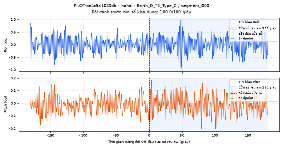
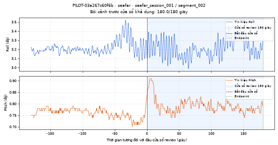
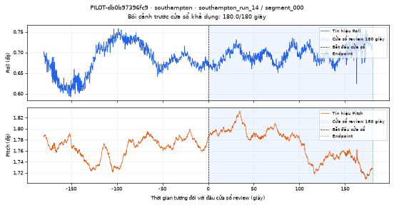

# Báo cáo Annotation Pilot

## Mục tiêu và trạng thái thực hiện

Pilot chuẩn bị **92 mẫu** từ review queue có sẵn; không tự gán nhãn. Có **0 quyết định đã cung cấp**, **0 nhãn HUMAN_REVIEWED**, **0 nhãn hazard vận hành VERIFIED**, **0 proxy** và **92 mẫu chưa gán nhãn**. Không có quyết định nào được tạo bởi script.

## Độ phủ pilot

| Nguồn | Mẫu | Session độc lập | Quyết định reviewer | HUMAN_REVIEWED | VERIFIED hazard | Normal envelope | UNLABELED | Median bối cảnh trước cửa sổ |
|---|---:|---:|---:|---:|---:|---:|---:|---:|
| Hohai | 84 | 21 | 0 | 0 | 0 | 0 | 84 | 100.0% coverage |
| Seafar | 4 | 1 | 0 | 0 | 0 | 0 | 4 | 100.0% coverage |
| Southampton | 4 | 1 | 0 | 0 | 0 | 0 | 4 | 80.6% coverage |

### Độ phủ theo session

#### Hohai

| Session | Mẫu | Đã review | Chưa review | Quyết định ACCEPTED theo lớp |
|---|---:|---:|---:|---|
| `Berth_B_T7_Type_A` | 4 | 0 | 4 | Chưa có bằng chứng lớp |
| `Berth_B_T8_Type_A` | 4 | 0 | 4 | Chưa có bằng chứng lớp |
| `Berth_B_T9_Type_A` | 4 | 0 | 4 | Chưa có bằng chứng lớp |
| `Berth_C_T7_Type_A` | 4 | 0 | 4 | Chưa có bằng chứng lớp |
| `Berth_C_T8_Type_A` | 4 | 0 | 4 | Chưa có bằng chứng lớp |
| `Berth_C_T9_Type_A` | 4 | 0 | 4 | Chưa có bằng chứng lớp |
| `Berth_D_T1_Type_A` | 4 | 0 | 4 | Chưa có bằng chứng lớp |
| `Berth_D_T2_Type_A` | 4 | 0 | 4 | Chưa có bằng chứng lớp |
| `Berth_D_T3_Type_A` | 4 | 0 | 4 | Chưa có bằng chứng lớp |
| `Berth_D_T3_Type_B` | 4 | 0 | 4 | Chưa có bằng chứng lớp |
| `Berth_D_T3_Type_C` | 4 | 0 | 4 | Chưa có bằng chứng lớp |
| `Berth_D_T4_Type_A` | 4 | 0 | 4 | Chưa có bằng chứng lớp |
| `Berth_D_T5_Type_A` | 4 | 0 | 4 | Chưa có bằng chứng lớp |
| `Berth_D_T6_Type_A` | 4 | 0 | 4 | Chưa có bằng chứng lớp |
| `Berth_D_T6_Type_B` | 4 | 0 | 4 | Chưa có bằng chứng lớp |
| `Berth_D_T6_Type_C` | 4 | 0 | 4 | Chưa có bằng chứng lớp |
| `Berth_D_T7_Type_A` | 4 | 0 | 4 | Chưa có bằng chứng lớp |
| `Berth_D_T8_Type_A` | 4 | 0 | 4 | Chưa có bằng chứng lớp |
| `Berth_D_T8_Type_B` | 4 | 0 | 4 | Chưa có bằng chứng lớp |
| `Berth_D_T8_Type_C` | 4 | 0 | 4 | Chưa có bằng chứng lớp |
| `Berth_D_T9_Type_A` | 4 | 0 | 4 | Chưa có bằng chứng lớp |

#### Seafar

| Session | Mẫu | Đã review | Chưa review | Quyết định ACCEPTED theo lớp |
|---|---:|---:|---:|---|
| `seafar_session_001` | 4 | 0 | 4 | Chưa có bằng chứng lớp |

#### Southampton

| Session | Mẫu | Đã review | Chưa review | Quyết định ACCEPTED theo lớp |
|---|---:|---:|---:|---|
| `southampton_run_14` | 4 | 0 | 4 | Chưa có bằng chứng lớp |

## Hồ sơ từng mẫu

CSV tại `ml/data/labels/annotation_pilot/annotation_pilot.csv` có một dòng cho mỗi mẫu: dataset/session/segment, window start/end, context trước cửa sổ, `plot_path`, metadata thử nghiệm, quality flags, bằng chứng cho quyết định, reviewer, quyết định, phenotype flags, ghi chú, thời điểm và review status. Trường reviewer/evidence được để trống hoặc UNVERIFIED cho đến khi có người điền thực tế.

Hình cho toàn bộ 92 mẫu được tạo trong `ml/data/labels/annotation_pilot/figures/`; mỗi hình thể hiện Roll/Pitch ở vùng lịch sử trước cửa sổ (nếu có) và cửa sổ 180 giây được tô màu. Bối cảnh không vượt ngược qua đầu session/segment; mẫu đầu có thể không có history trước đó. Cột `context_coverage_fraction` ghi rõ độ phủ đo được.

### Một số hình đại diện

- Hohai, `PILOT-be4c5a1039db`: độ phủ context 100.0%.

  
- Seafar, `PILOT-03a267c60f6b`: độ phủ context 100.0%.

  
- Southampton, `PILOT-db0b97396fc9`: độ phủ context 100.0%.

  

## Metadata và cảnh báo chất lượng

- Seafar: dữ liệu tàu thật, một session; duplicate/gaps đã tách segment. Rate-axis/sign chưa xác nhận và offset nền không phải bằng chứng hazard.
- Hohai: mỗi workbook sheet là session thử nghiệm riêng; tên `Berth`/`Type` là metadata thí nghiệm. Thời gian suy từ 50 Hz và dropout không thể kiểm tra từ workbook.
- Southampton: bốn mẫu pilot thuộc Run 14. Test Plan ghi điều kiện thử nghiệm `R1`, wave frequency khoảng 0,7976 Hz, amplitude khoảng 0,01927 m; đây chỉ là provenance, không phải hazard label. Delta Angle chưa map sang gyro canonical.
- Quality flags theo từng mẫu lấy từ feature validity/provenance hiện hữu; các trường không VALID không bị che đi.

## Kết quả review và đa nhãn

Quyết định thực tế: 0; mẫu ambiguous: 0; mẫu có nhiều phenotype flags: 0. Phân bố decision counts: `{"AMPLITUDE_GROWTH": 0, "HIGH_ROLL": 0, "NORMAL": 0, "PERSISTENT_OFFSET": 0, "REVIEW_REQUIRED": 0, "UNLABELED": 92}`.

Inter-reviewer agreement: chưa tính — Chưa có ít nhất hai reviewer với quyết định ACCEPTED trên cùng sample.

Không diễn giải đồng thuận của reviewer thành độ chính xác hazard. Người xem tín hiệu chỉ có thể ghi `OBSERVED_MOTION_PHENOTYPE`; để ghi `VERIFIED_OPERATIONAL_HAZARD` cần external evidence riêng. `NORMAL` yêu cầu `VERIFIED_NORMAL_ENVELOPE` có reference vận hành được chấp nhận.

## Kiểm thử và kiểm chứng

Bài kiểm thử tự động gần nhất: **70 passed in 2.69s**; exit code `0`. Lệnh: `python -m pytest ml/labeling/tests ml/features/tests ml/preprocessing/tests ml/audit -q`. Kiểm thử kiểm tra schema, chống thăng cấp nhãn chưa review, provenance, identity/window matching, ranh giới session, revision audit và tính tái lập; fixture tổng hợp chỉ dùng trong unit test.

## Chống bias và leakage

Mỗi hình chỉ có tín hiệu Roll/Pitch, ranh giới cửa sổ và metadata; không vẽ ngưỡng phân lớp. `queue_suggested_label` được giữ như thông tin kiểm toán, nhưng người review nên đánh giá tín hiệu trước khi xem trường này. Cửa sổ 180 giây stride 10 giây chồng lấn khoảng 94,4%; các hàng cùng session không độc lập. Mọi split downstream phải group theo session/run/sheet, không chia random theo cửa sổ.

## Giải thích kỹ thuật phục vụ vấn đáp

**Em đã làm gì?** Đóng gói 92 mẫu có sẵn thành form có khóa ổn định, signal plot, lịch sử trước cửa sổ, provenance và quality flags. **Vì sao?** Người review cần xem tín hiệu trong bối cảnh mà vẫn giữ ranh giới session/segment. **Phương pháp?** Ghép chính xác theo session/segment/window endpoint và chỉ đọc Parquet processed; hình thể hiện `(t-180,t]` cùng context trước cửa sổ. **Kết quả thực tế?** Từng mẫu có PNG và CSV form; quyết định thực tế được đếm từ form/ledger. **Nếu coi wave hoặc góc lớn là nhãn?** Sẽ suy diễn hazard từ điều kiện/đại lượng chuyển động mà không có reference vận hành. **Giới hạn?** Context có thể thiếu ở đầu segment; hình thị giác không thay thế xác nhận sự kiện hoặc chuyên gia vận hành.
