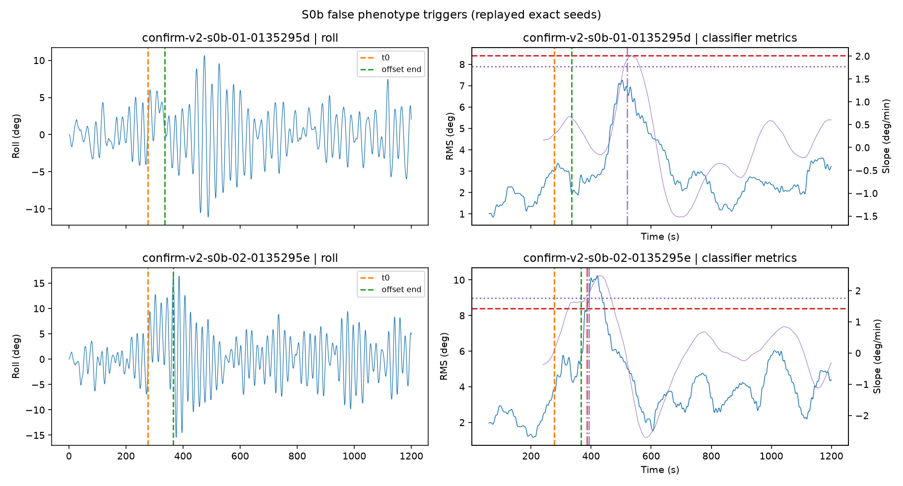
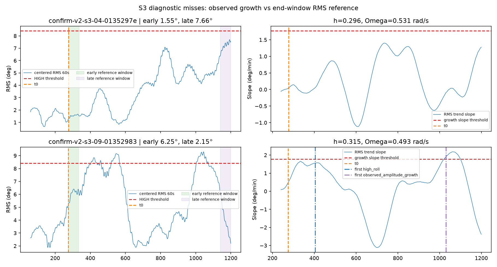

# Labeling v2 Failure Analysis and Calibration Refinement Plan

## Scope and method

This analysis replays the exact G1 seeds for the two S0b false-trigger sessions and two S3 diagnostic misses from the independent confirmation metadata. The candidate configuration and labeler were left unchanged. Confirmation traces were regenerated in memory from seed, configuration and generator version; no large trace file was written. The 60-session confirmation cohort is used here to explain failure modes only, not to choose or tune thresholds.

The frozen candidate remains `candidate`, not calibrated:

| Rule | Candidate setting |
|---|---:|
| HIGH_ROLL | Centered population std, 60 s, ≥ 8.40884426° |
| PERSISTENT_OFFSET | Absolute signed mean ≥ 3° over trailing 180 s, continuously for ≥ 120 s |
| AMPLITUDE_GROWTH | RMS trend slope ≥ 1.769349623333755°/min continuously for 10 s |
| Growth ratio | Diagnostic only; threshold and floor are `null`, so ratio is not in the active predicate |

The labeler receives the current and past clean roll samples. Event time, scenario, heel truth, sea-state ID, `h`, and `Omega` are used only to group and explain the replay results.

## 1. S0b false triggers

Both affected sessions had temporary offsets shorter than 120 s and correctly did **not** trigger PERSISTENT_OFFSET. Their other triggers came from the simulated roll response and the independent HIGH_ROLL / AMPLITUDE_GROWTH criteria.

| Session / seed | Temporary offset | Trigger | Metrics at first trigger | Relation to event |
|---|---|---|---|---|
| `confirm-v2-s0b-01-0135295d` / `20261213` | +3.1022°, 58.20 s; t0=277.25 s, end=335.45 s | AMPLITUDE_GROWTH at 519.45 s; active interval 519.45–561.80 s | mean180 −0.4871°; centered RMS60 6.8488°; slope 1.9249°/min; ratio180 2.4942; heel input 0°; primary label AMPLITUDE_GROWTH | First slope-threshold run began 509.45 s, 174.0 s after offset end; phenotype began 184.0 s after end. |
| `confirm-v2-s0b-02-0135295e` / `20261214` | +5.2136°, 88.45 s; t0=277.30 s, end=365.75 s | HIGH_ROLL at 385.65 s; flag interval 385.65–444.65 s. AMPLITUDE_GROWTH also became active at 392.00 s. | mean180 +2.3882°; centered RMS60 8.4114°; slope 1.8240°/min; ratio180 2.5942; heel input 0°; roll sample +16.4338°; primary label HIGH_ROLL | HIGH_ROLL began 19.90 s after offset end; growth began 26.25 s after end. |

For session 02, the centered RMS was only **0.00256°** above the frozen HIGH_ROLL threshold. This is a near-boundary crossing, not a large threshold overshoot. The 180 s mean was below 3°, so the persistent-offset phenotype remained inactive. At the later growth onset, slope was 1.9168°/min and centered RMS was 8.7828°; the high phenotype still had priority.

The most plausible explanation is a combination of the roll response to the start and removal of the heel forcing, the G1 correlated wave input, and rolling-window thresholds. The timing is consistent with residual/transient motion: one event is late after offset removal, while the other follows it by about 20 s. These are real excursions in the simulated clean roll, not sensor noise or metadata leakage. The evidence does not prove that the heel edge alone caused either crossing; the sea state, sampled T0/damping and stochastic forcing also contribute. The S0b expectation of NORMAL is therefore in tension with a morphology-only classifier that is allowed to flag sufficiently large or rising roll after a temporary event.

The growth ratio values above would not change either decision: the selected rule is slope-only and ratio threshold/floor are null. Both slope-trigger intervals outlast the current 10 s confirmation (52.4 s and 84.1 s above threshold), so a small confirmation increase would not automatically remove them.

## 2. S3 outcome analysis

On the 10 confirmation sessions, the retrospective endpoint reference reported RMS increase in 9/10, the causal growth phenotype triggered in 9/10, and both were true in 8/10. These are different checks: the endpoint reference compares generator RMS-about-zero over the first post-t0 60 s with the last 60 s, while the live labeler uses a 180 s regression slope of rolling 60 s centered standard deviation. Neither check is independent evidence about a real vessel.

| Session / seed | Event and dynamics | RMS reference (first post-t0 60 s → final 60 s) | Live evidence and result |
|---|---|---|---|
| `confirm-v2-s3-04-0135297e` / `20261246` | h=0.2964; Omega=0.5308 rad/s; T0=23.6764 s; damping=0.04607; SS1 forcing | 1.5485° → 7.6609° (**increase**) | No HIGH_ROLL or growth phenotype. Maximum slope was 1.3985°/min, below 1.7693°/min for the whole session; max ratio was 4.3922, but ratio is not active. Centered RMS rose slowly: median slope in the final interval was 0.3781°/min and its maximum was 1.3985°/min. This is a genuine miss of slow observed growth under the current slope rule. |
| `confirm-v2-s3-09-01352983` / `20261251` | h=0.3152; Omega=0.4926 rad/s; T0=25.5105 s; damping=0.04837; SS2 forcing | 6.2536° → 2.1494° (**decrease**) | HIGH_ROLL began t0+129.65 s. A later positive slope run lasted 80.0 s (1020.40–1100.35 s); growth phenotype began at t0+756.05 s, with slope 1.9044°/min and ratio 2.1201. Thus the live growth phenotype fired despite the session-level endpoint decrease. At its onset HIGH_ROLL also had priority; across this session 829 growth-active samples overlapped HIGH_ROLL, while 571 samples carried the AMPLITUDE_GROWTH primary label. |

Across S3, 11,598 of 16,818 growth-phenotype samples also had HIGH_ROLL active (about 69%). Because HIGH_ROLL is first in the priority order, only 5,220 samples carried AMPLITUDE_GROWTH as the primary class. This does not mean the growth phenotype was absent; it means the one-class output masks it during overlap. Keep the independent phenotype flags when measuring detection and do not use the primary class alone as the growth metric.

The S3 misses have different causes: one response rose but never met the selected slope threshold; another showed a late local growth trend after initially large motion had contracted, so it passed the causal slope rule but failed the generator's early-versus-final endpoint check. Parametric excitation being active does not guarantee sustained amplification. The nonlinear coefficient is the configured 25° reference assumption in these runs, not a vessel-calibrated parameter.

## 3. Warm-up and window audit

Each session has 24,000 samples at 20 Hz (`dt=0.05 s`, timestamps 0 through 1199.95 s). The report's 48,010 warm-up/unknown samples per scenario equals 4,801 per session times 10 sessions. Labels are evaluated at every 20 Hz sample; these are not 2 Hz output windows.

| Dependency | Samples required by source | Earliest metric time |
|---|---:|---:|
| Centered population std over 60 s | 60/0.05 + 1 = 1,201 raw samples | 60.00 s |
| Trailing signed mean over 180 s | 180/0.05 + 1 = 3,601 raw samples | 180.00 s |
| 180 s trend over the 60 s centered-std series | 3,601 centered-std values, first available at 60.00 s | nominal 240.00 s |
| Growth confirmation | 10 s continuously beyond the slope threshold | adds 10 s to a positive growth phenotype, not to normal-label readiness |

The online class needs all three phenotype metrics to be decidable. Growth slope is therefore the limiting dependency. In the current implementation, `_append_growth_value` returns no slope on the call that first fills its 3,601-value deque; slope is calculated on the next sample. Consequently the first class appears at **240.05 s**, not 240.00 s. The 0.05 s difference is one extra sample (the inclusion of both endpoints itself is correct). This accounts exactly for 4,801 initial `None` labels at timestamps 0 through 240.00 s per session. It is a small warm-up bookkeeping discrepancy against the recorded `60 + 180 = 240 s` requirement, not a broad window shift or future-data leak.

The 180 s trend is intentionally nested on top of a rolling 60 s statistic, so the signal dependency reaches roughly 240 s into the past. The 120 s ratio lag is diagnostic only under this candidate; it does not set readiness. The 180 s mean becomes available earlier, but cannot make the final class available before growth metrics. Persistent-offset confirmation is timed from the first sample where the signed rolling mean reaches the threshold; a drop below threshold resets that timer. It is not simply `t0 + 120 s` and does not consume event metadata.

## 4. Detection latency

Latency below is event-relative and calculated from the first phenotype at or after t0. For H1, combined latency is the later of first HIGH_ROLL and first PERSISTENT_OFFSET. All values are descriptive at n=10; S3 growth latency is based on the 9 detections.

| Scenario / phenotype | Detections | Median (s) | P90 (s) | P95 (s) | Interpretation |
|---|---:|---:|---:|---:|---|
| S1 HIGH_ROLL | 10/10 | 145.23 | 253.25 | 279.10 | Depends on sea forcing, sampled roll parameters, and the 60 s centered statistic crossing the threshold. |
| S2 PERSISTENT_OFFSET | 10/10 | 223.78 | 252.91 | 266.20 | Includes response of the 180 s mean to the forced offset plus a continuous 120 s qualifying interval. |
| S3 observed growth | 9/10 | 126.65 | 384.53 | 570.29 | Long tail includes slow/local slope crossings; one session had no growth flag. |
| H1 first abnormal phenotype (any of high, persistent, growth) | 10/10 | 61.03 | 207.61 | 227.20 | Earliest phenotype only; often HIGH_ROLL or growth. |
| H1 HIGH_ROLL | 10/10 | 94.63 | 264.36 | 343.38 | Separate from persistent-offset detection. |
| H1 PERSISTENT_OFFSET | 10/10 | 249.23 | 680.00 | 762.35 | Dominates the tail when signed mean is near/under 3° and the continuous timer resets. |
| H1 both HIGH_ROLL and PERSISTENT_OFFSET | 10/10 | 260.30 | 680.00 | 762.35 | Time until the slower of the two required phenotypes appears. |

H1's “first abnormal” is not the combined detection time. Reporting just one latency obscures that the first roll excursion can be early while the persistent-offset phenotype arrives several minutes later. Preserve all three H1 component latencies in future validation summaries.

## 5. Calibration round 2 options (not executed)

| Option | Potential benefit | Risks / required evaluation |
|---|---|---|
| Keep current candidate unchanged | Preserves the only currently comparable rule; avoids reacting to individual confirmation sessions. | Not ready to lock: S0b false triggers and S3 slope/endpoint disagreement remain unexplained at cohort level. |
| Re-survey HIGH_ROLL threshold on new Train, choose on new Validation | Measures the S0b-vs-S1/H1 trade-off using session-level rates. | Raising the threshold could remove a near-boundary S0b crossing but can miss lower-amplitude S1/H1 behavior and may increase latency. Do not set a new numeric threshold from the single 8.4114° event. |
| Re-survey growth slope and confirmation together | Can quantify false growth during temporary-offset response versus slow S3 growth. | A higher slope misses S3-04; a lower slope can add transient/noise false triggers. A longer confirmation alone is unlikely to remove both S0b runs because their above-threshold intervals lasted 52.4 s and 84.1 s. |
| Evaluate slope-plus-ratio as a separate candidate family | Could require both a trend and a relative increase. | Ratio is currently not active; its floor and threshold are unset. S0b false-growth ratios were already 2.49 and 2.42, and S3-09 was 2.12, so a ratio condition is not automatically discriminative. Define and validate its floor to avoid unstable ratios when the older RMS denominator is small. |
| Test a signal-only transient/dwell or hysteresis rule | May reduce flags from short-lived roll responses without using scenario ID/t0/heel truth. | Adds latency and may suppress real S1/H1 onset. The current 60 s RMS already smooths excursions; test the signal-only rule against all scenario cohorts before adoption. |
| Leave persistent-offset thresholds unchanged pending more evidence | Current S2 and H1 phenotype detection is 10/10. | H1 P90/P95 latency is high. Any shorter qualifying duration or lower mean threshold risks false persistent triggers; evaluate signed-mean trajectories and reset counts first. |

Do not tune the thresholds from the 60-session confirmation or use its outcomes as the threshold-selection set. The evidence supports a new calibration study, but not a particular replacement value. Treat candidate alternatives as a grid evaluated at the **session** level; overlapping time samples are not independent observations. Report phenotype flags, priority labels, event exposure and observed movement separately.

## 6. Calibration data plan

Recommended clean round-2 cohort: **30 Train + 20 Validation sessions per scenario** (300 total, six scenarios). Use new session IDs and seeds disjoint from both the existing 90-session pilot and the sealed 60-session confirmation. Keep all records in Train/Validation; do not create or inspect Test-G1/Test-G2. An economy option is to add 20 Train + 15 Validation per scenario to the existing 10/5 pilot counts, but the fully new cohort avoids inheriting round-1 threshold-selection history.

1. Freeze this confirmation metadata/report as historical evidence; never append new traces to the 60-session cohort.
2. Generate the new G1 Train/Validation cohort with the same documented candidate profile and no changes to generator dynamics during threshold comparison.
3. Inspect S0b transient cases, S3 trend-vs-endpoint disagreement, S1/H1 high-roll sensitivity, and H1 persistent-offset latency by session. Select candidate families on Train and choose among them on Validation only.
4. Record full candidate values, sample/session counts, missed outcomes, false-trigger rates, latency percentiles and phenotype overlap. Keep `calibrated=false` / status `candidate` until the group approves.
5. After a candidate is selected and approved for confirmation, create a **new** independent confirmation cohort with fresh seeds. Keep this old confirmation only as a historical, post-hoc failure analysis.

## 7. Remaining risks

- Ten confirmation sessions per scenario provide coarse, unstable session-level rates; window counts must not be treated as independent sample size.
- The S0b scenario expectation “NORMAL” may conflict with observed roll morphology after its temporary heel forcing. A classifier using only roll cannot know the event was benign unless that expectation is encoded into an allowed signal-only rule; scenario metadata must remain excluded from labels and ML features.
- The S3 endpoint reference is retrospective and uses a different statistic from the causal growth detector. It is a useful diagnostic, not label ground truth.
- HIGH_ROLL priority masks simultaneous growth/offset in the primary class. Downstream evaluation should retain independent phenotype flags.
- The simulated nonlinear coefficient is a reference assumption; sea-state sigma values are equivalent-angle forcing candidates. Neither is validated against vessel measurements.
- H1 persistent detection has a long tail, especially for signed mean near the 3° boundary. Reducing that latency may trade against offset false positives.
- There is a one-sample discrepancy between the documented 240 s warm-up and actual first-label time 240.05 s. It should be handled in a separate, tested implementation change, not silently folded into calibration.

## Artifacts and source basis

Exact-seed replay plots:

- [S0b false-trigger replay](labeling_v2_failure_s0b.png)
- [S3 outcome-miss replay](labeling_v2_failure_s3.png)

Reproducibility source: `labeling_v2_independent_validation.json`, candidate threshold source: `labeling_v2_candidate.json`. Analysis references `CausalMotionLabelerV2._sample_count`, `_append_growth_value`, `step`, `ScenarioRunner`'s S0b/S3 event planning and S3 endpoint outcome check. No source logic, candidate JSON, tests, G2, official dataset or ML model was changed or generated in this step.
